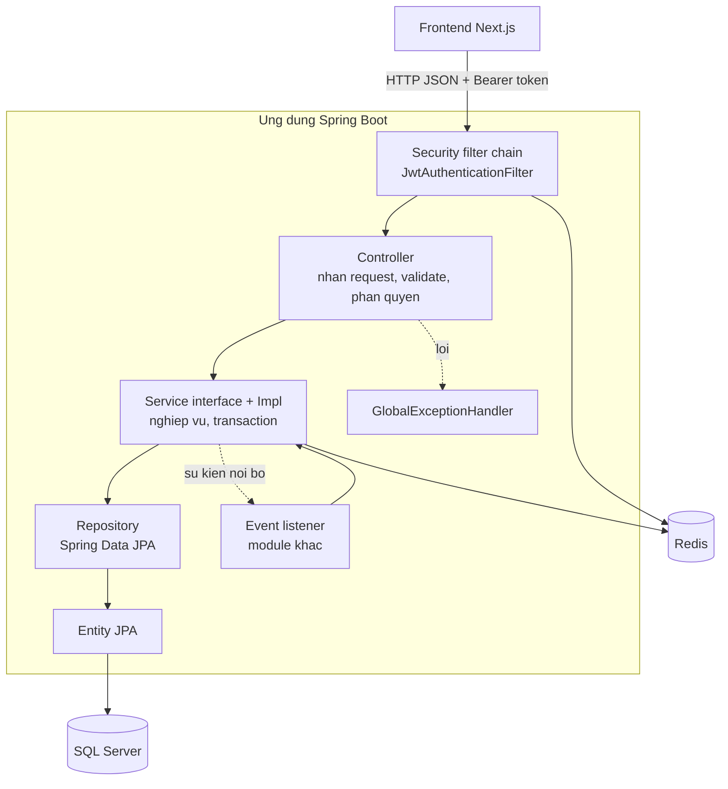
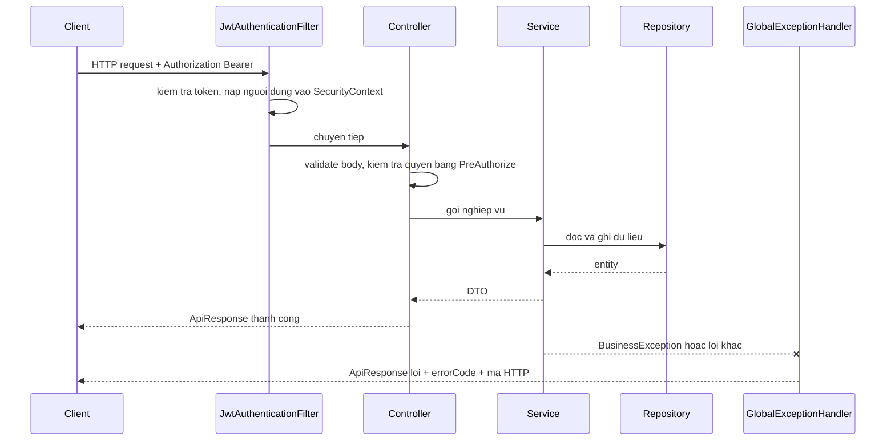
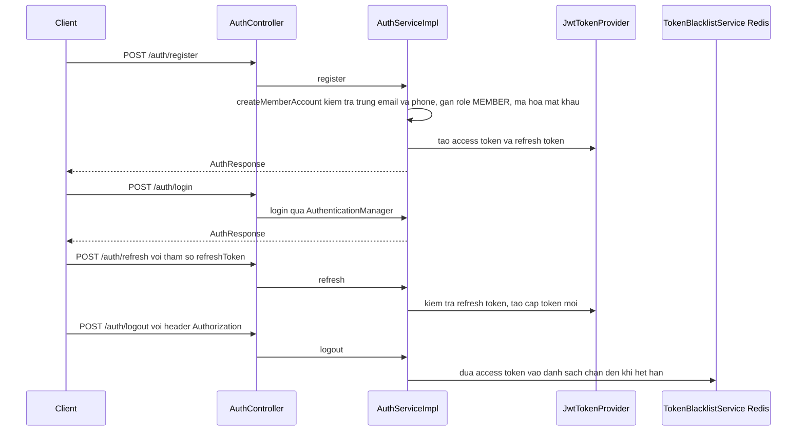
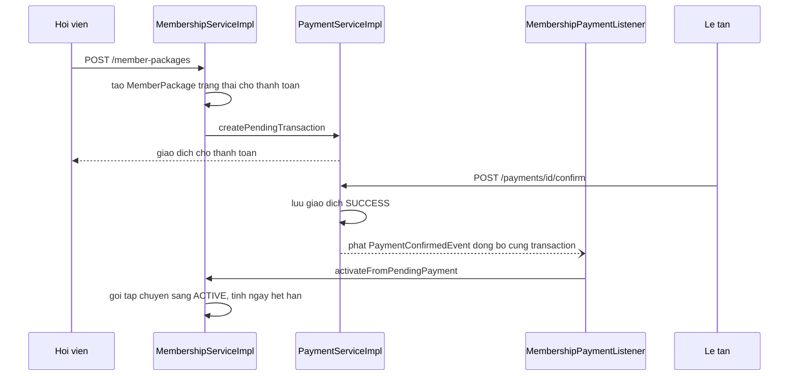
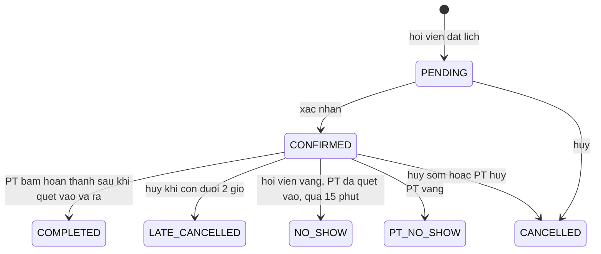
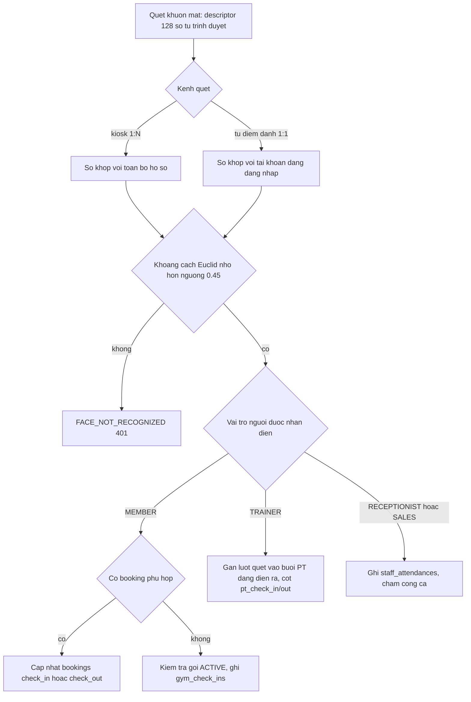
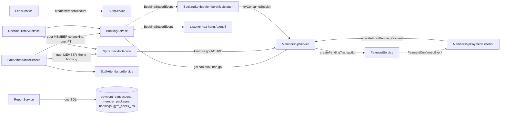
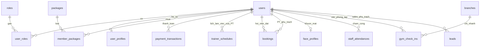

# Kiến trúc backend và cách hoạt động của các nghiệp vụ

Tài liệu mô tả backend của Gym Management System: mô hình kiến trúc, cấu trúc thư mục, file nào gọi file nào, và luồng chạy của từng nghiệp vụ.

> **Độ tin cậy.** Tài liệu được viết từ các thông báo, log, DTO và controller đã xem trong quá trình làm dự án, **chưa phải từ việc đọc toàn bộ mã nguồn**. Phần nào chưa xác minh được ghi rõ bằng dấu *(chưa xác minh)*. Mục 12 có lệnh để đối chiếu danh sách file thật với tài liệu này.

---

## 1. Mô hình kiến trúc

Backend là **một ứng dụng Spring Boot duy nhất (monolith)**, tổ chức theo **kiến trúc phân lớp (layered / n-tier)**, chia nghiệp vụ thành các **module** do từng agent phụ trách. Các module nằm chung một ứng dụng, một cơ sở dữ liệu, một lần triển khai.

| Đặc điểm | Mô tả |
|---|---|
| Kiểu kiến trúc | Layered monolith: Controller, Service, Repository, Entity |
| Cách chia mã | Theo **lớp** (`controller/`, `service/`, `repository/`...), không theo nghiệp vụ; module nhận biết qua tên file và agent phụ trách |
| Giao tiếp giữa module | Gọi qua **interface của service**, và qua **sự kiện nội bộ** (Spring `ApplicationEvent`, chạy đồng bộ, cùng transaction) để tránh phụ thuộc vòng |
| Xác thực | **Stateless JWT** (access token ngắn hạn + refresh token); đăng xuất đưa access token vào danh sách chặn trong Redis |
| Dữ liệu | SQL Server; schema quản lý bằng **Flyway** (migration có đánh số, `out-of-order` được bật) |
| API | REST, tiền tố `/api/v1`, mọi response bọc trong `ApiResponse`, tài liệu bằng Swagger/OpenAPI |



Quy tắc phụ thuộc (đã được áp dụng sau sự cố vòng phụ thuộc giữa `MembershipServiceImpl` và `PaymentServiceImpl`):

1. Controller chỉ gọi **service (interface)**, không gọi repository.
2. Service gọi repository của **chính module mình**; muốn dữ liệu module khác thì gọi **service interface** của module đó.
3. Hai module không được phụ thuộc nhau theo vòng. Khi cần "A xong thì B làm tiếp", A **phát sự kiện**, B lắng nghe (ví dụ thanh toán xong thì gói tập được kích hoạt).
4. Có một test dựng Spring context thật và cấm vòng phụ thuộc; vòng mới sẽ làm `mvn verify` đỏ.

---

## 2. Công nghệ

| Thành phần | Công nghệ |
|---|---|
| Ngôn ngữ, khung | Java 17, Spring Boot 3.3.4 (Web, Data JPA, Security, Validation, Actuator, Redis) |
| ORM, cơ sở dữ liệu | Hibernate 6.5, SQL Server (JDBC `mssql-jdbc` 12.6), Flyway 10 |
| Bộ nhớ đệm, khoá | Redis (danh sách chặn token, chống quét khuôn mặt trùng) |
| Bảo mật | Spring Security, JJWT 0.12.5, BCrypt |
| Tài liệu API | springdoc-openapi 2.6.0 (Swagger UI `/swagger-ui.html`, `/v3/api-docs`) |
| Hỗ trợ mã | Lombok, MapStruct (có trong dependency) |
| Kiểm thử | JUnit 5, Mockito, Spring Test, H2 |
| Triển khai | Jenkins, Maven, Windows service (NSSM), SQL Server và Redis chạy trong Docker |

---

## 3. Cấu trúc thư mục

Gốc: `src/main/java/com/gym/management/`

```
config/            Cấu hình: SecurityConfig, OpenApiConfig, ...
security/          JWT và xác thực: JwtTokenProvider, JwtAuthenticationFilter,
                   CustomUserDetailsService, GymUserDetails, TokenBlacklistService,
                   chú thích lấy người dùng hiện tại (CurrentUser...)
controller/        REST controller: AuthController, ProfileController, PackageController,
                   MembershipController, PaymentController, ScheduleController, BookingController,
                   FaceProfileController, FaceAttendanceController, StaffAttendanceController,
                   CheckInController, LeadController, ReportController
service/           Interface nghiệp vụ (AuthService, MembershipService, PaymentService, BookingService...)
service/impl/      Cài đặt (AuthServiceImpl, MembershipServiceImpl, PaymentServiceImpl, ...)
service/event/     Sự kiện nội bộ: PaymentConfirmedEvent, BookingSettledEvent
                   và các listener (MembershipPaymentListener, BookingSettledMembershipListener)
repository/        Spring Data JPA: UserRepository, RoleRepository, PackageRepository,
                   MemberPackageRepository, PaymentTransactionRepository, BookingRepository,
                   TrainerScheduleRepository, FaceProfileRepository, StaffAttendanceRepository,
                   GymCheckInRepository, LeadRepository, ReportRepository (SQL thuần cho báo cáo)
entity/            Entity JPA: BaseEntity, User, Role, Branch, UserProfile, Package, MemberPackage,
                   PaymentTransaction, TrainerSchedule, Booking, FaceProfile, StaffAttendance,
                   GymCheckIn, Lead và các enum trạng thái
dto/request/       Dữ liệu vào (LoginRequest, RegisterRequest, UpdateProfileRequest, ...)
dto/response/      Dữ liệu ra (AuthResponse, ProfileResponse, PageResponse, ...)
exception/         BusinessException, ErrorCode, ApiResponse, GlobalExceptionHandler
integration/       Tích hợp ngoài: hardware (so khớp khuôn mặt), vietqr, zalo (khung giữ chỗ)
constant/, util/   Hằng số và hàm tiện ích
```

Ngoài mã Java:

```
src/main/resources/
  application.yml                 Cấu hình chung (không chứa bí mật)
  application-local.example.yml   Mẫu cấu hình máy cục bộ (file thật application-local.yml bị .gitignore)
  db/migration/                   Flyway: V1, V2, V2_1, V2_2, V3, V4, V6, V9 ... (V5, V7, V8 đang chờ vào master)
src/test/java/...                 Kiểm thử đơn vị và test dựng Spring context
```

---

## 4. Vòng đời một request



**Định dạng chung của mọi response** (`ApiResponse`):

```json
{ "success": true, "message": "...", "data": { }, "errorCode": null, "timestamp": "..." }
```

Thất bại: `success = false`, `errorCode` là tên trong `ErrorCode` (ví dụ `BOOKING_SLOT_TAKEN`), mã HTTP lấy từ `ErrorCode.getHttpStatus()`.

`GlobalExceptionHandler` chuyển lỗi thành `ApiResponse`:

| Lỗi | HTTP | errorCode |
|---|---|---|
| `BusinessException` | theo `ErrorCode` | theo `ErrorCode` |
| Dữ liệu vào sai (`@Valid`, JSON sai, tham số sai kiểu, `ConstraintViolation`) | 400 | `VALIDATION_ERROR` |
| Sai thông tin đăng nhập | 401 | `AUTH_INVALID_CREDENTIALS` |
| Thiếu quyền (`@PreAuthorize`) | 403 | `AUTH_FORBIDDEN_ROLE` |
| Vi phạm unique/khoá ngoại ở DB | 409 | `DATA_CONFLICT` |
| Lỗi không lường trước | 500 | `INTERNAL_SERVER_ERROR` |

Người chưa đăng nhập gọi endpoint cần xác thực hiện nhận 403 body rỗng do Spring Security; đã có bản sửa chờ gắn vào `SecurityConfig` để trả 401 JSON (`AUTH_TOKEN_INVALID`).

---

## 5. Quy ước dùng chung

| Chủ đề | Quy ước |
|---|---|
| Khoá chính | `UUID` (`BaseEntity.id`); `BaseEntity` có `createdAt`, `updatedAt` kiểu `LocalDateTime` |
| Thời gian | `LocalDateTime` theo giờ Việt Nam. Mọi chỗ lấy "bây giờ" dùng bean `Clock` (`BookingClockConfig`), không dùng `now()` trần, để test giả lập được thời gian |
| Phân trang | `?page=0&size=20&sort=...` trả `PageResponse` (`content`, `page`, `size`, `totalElements`, `totalPages`) |
| Phân quyền | Vai trò: `SUPER_ADMIN`, `RECEPTIONIST`, `SALES`, `TRAINER`, `MEMBER`. Quy tắc theo đường dẫn ở `SecurityConfig`, chi tiết hơn ở `@PreAuthorize` trên controller |
| Transaction | `@Transactional` ở service. Sự kiện phát đồng bộ nên listener chạy **chung** transaction với bên phát |
| Migration | Không sửa migration đã merge; đổi schema thì thêm file mới. `spring.flyway.out-of-order: true` cho phép số nhỏ merge sau |
| Mật khẩu, token | BCrypt; access token 15 phút; refresh token dài hơn; không ghi log token |

---

## 6. Bản đồ module: file nào thuộc module nào

| Module | Controller | Service (interface → impl) | Repository | Entity | Migration |
|---|---|---|---|---|---|
| **Auth, Hồ sơ** (Agent 1) | `AuthController`, `ProfileController` | `AuthService`, `ProfileService` | `UserRepository`, `RoleRepository`, `UserProfileRepository`, `BranchRepository` | `User`, `Role`, `Branch`, `UserProfile` | V1, V2.1, V9 |
| **Gói tập, Membership, Thanh toán** (Agent 2) | `PackageController`, `MembershipController`, `PaymentController` | `PackageService`, `MembershipService`, `PaymentService` | `PackageRepository`, `MemberPackageRepository`, `PaymentTransactionRepository` | `Package`, `MemberPackage`, `PaymentTransaction` | V2, V2.2 |
| **Lịch PT, Booking** (Agent 3) | `ScheduleController`, `BookingController` | `TrainerScheduleService`, `BookingService` | `TrainerScheduleRepository`, `BookingRepository` | `TrainerSchedule`, `Booking`, `BookingStatus` | V3 |
| **Điểm danh khuôn mặt, chấm công** (Agent 4) | `FaceProfileController`, `FaceAttendanceController`, `StaffAttendanceController`, `CheckInController` | `FaceProfileService`, `FaceAttendanceService`, `StaffAttendanceService`, `GymCheckInService`, `CheckInHistoryService` | `FaceProfileRepository`, `StaffAttendanceRepository`, `GymCheckInRepository` | `FaceProfile`, `StaffAttendance`, `GymCheckIn` | V4, V8 |
| **Leads/CRM, Báo cáo** (Agent 6) | `LeadController`, `ReportController` | `LeadService`, `ReportService` | `LeadRepository`, `ReportRepository` | `Lead`, `LeadStatus` | V6 |
| **POS, Hoa hồng** (Agent 5) | *chưa vào master* | *chưa vào master* | *chưa vào master* | *chưa vào master* | V5 (chờ) |

Hầu hết `*Service` có lớp `*ServiceImpl` trong `service/impl/`.

---

## 7. Các nghiệp vụ và luồng chạy

### 7.1 Xác thực (Auth)

**File liên quan:** `AuthController` → `AuthService`/`AuthServiceImpl` → `UserRepository`, `RoleRepository`, `PasswordEncoder`, `AuthenticationManager`, `JwtTokenProvider`, `TokenBlacklistService`. Bộ lọc: `JwtAuthenticationFilter`. Người dùng cho Spring Security: `CustomUserDetailsService`, `GymUserDetails`.



Quy tắc chính:
- Đăng ký chỉ tạo tài khoản `MEMBER`; email và số điện thoại không được trùng (`AUTH_EMAIL_ALREADY_EXISTS`, `AUTH_PHONE_ALREADY_EXISTS`). Số điện thoại trống thành `NULL`; nhiều tài khoản không có số được phép (filtered unique index, V9).
- Nhân viên (lễ tân, PT, sales, quản trị viên) không tự đăng ký; được cấp qua dữ liệu.
- `AuthService.createMemberAccount(fullName, email, phone, rawPassword)` được dùng chung cho đăng ký và cho việc chuyển lead thành hội viên (module Leads); không phát token.
- `refresh` nhận `refreshToken` dạng tham số (`@RequestParam`), không nhận JSON.
- Mỗi request có token: `JwtAuthenticationFilter` kiểm tra token và nạp người dùng vào `SecurityContext`. Token đã bị chặn khi đăng xuất bị từ chối *(thuật toán kiểm tra danh sách chặn trong bộ lọc: chưa xác minh)*.

### 7.2 Hồ sơ cá nhân

**File:** `ProfileController` → `ProfileService`/`ProfileServiceImpl` → `UserProfileRepository`, `UserRepository`, `Clock`.

- `GET/PUT /profile/me`, `POST /profile/me/avatar` (trường tệp tên `image`).
- Nhập `dateOfBirth`; rule: từ **18 tuổi trở lên tính đến ngày đăng ký** (`User.createdAt`), không quá 120 tuổi; sai thì `PROFILE_INVALID_AGE`. Response trả thêm `age` tính sẵn.
- Ảnh đại diện chỉ lưu ở `user_profiles.avatar_url`.

### 7.3 Gói tập, Membership, Thanh toán (Agent 2)

**File:** `PackageController`, `MembershipController`, `PaymentController` → `PackageService`, `MembershipService`, `PaymentService` → `PackageRepository`, `MemberPackageRepository`, `PaymentTransactionRepository`. Sự kiện: `PaymentConfirmedEvent`; listener: `MembershipPaymentListener`.



Quy tắc chính:
- **Gói công khai:** `GET /packages`, `GET /packages/{id}` không cần đăng nhập, chỉ trả gói đang mở bán (gói ngừng bán trả 404). Quản trị gói ở `/packages/admin/**` (chỉ Super Admin); "xoá" là **ngừng bán**, không xoá bản ghi.
- **Đăng ký gói:** tạo gói chờ thanh toán và giao dịch chờ; lễ tân hoặc Super Admin xác nhận thanh toán thì gói mới `ACTIVE`.
- **Hạn gói:** `end_date = start_date + duration_days - 1` (tính cả ngày cuối). Nếu hội viên đã có gói, gói mới bắt đầu ngay sau `end_date` của gói cũ.
- **Nâng cấp, hạ cấp:** `POST /member-packages/{id}/upgrade|downgrade`. Hạ cấp được lên lịch và tính tiền ngay, không qua bước xác nhận.
- `PaymentServiceImpl` **không** gọi `MembershipService`; chỉ phát sự kiện. Đây là cách gỡ vòng phụ thuộc cũ.
- `MembershipService.tryConsumeSession(memberId)` trừ một buổi và **không ném lỗi nghiệp vụ**, để không làm hỏng transaction của bên gọi.
- Doanh thu (báo cáo) chỉ cộng giao dịch `SUCCESS`.

### 7.4 Lịch PT và Booking (Agent 3)

**File:** `ScheduleController`, `BookingController` → `TrainerScheduleService`, `BookingService`/`BookingServiceImpl` → `TrainerScheduleRepository`, `BookingRepository`, `Clock`. Sự kiện: `BookingSettledEvent`; listener: `BookingSettledMembershipListener`.

Vòng đời booking:



Quy tắc chính:
- **Đặt lịch** kiểm tra: trong giờ làm việc của PT (`BOOKING_OUT_OF_WORKING_HOURS`), không đặt quá sát giờ (`BOOKING_TOO_SOON`), khung giờ chưa bị đặt (`BOOKING_SLOT_TAKEN`, 409), hội viên không bị trùng lịch (`BOOKING_DOUBLE_BOOKED`), giới hạn số buổi mỗi tuần (`BOOKING_WEEKLY_LIMIT_EXCEEDED`), và gói còn buổi, còn hạn.
- **Trạng thái tự cập nhật khi đọc** (lazy-status): không có job nền; việc chuyển sang `NO_SHOW` hay `PT_NO_SHOW` xảy ra khi booking được đọc.
- **Chốt buổi** phát `BookingSettledEvent(bookingId, trainerId, memberId, outcome, fullDuration, settledAt)` với `outcome` ∈ `COMPLETED`, `MEMBER_NO_SHOW`, `LATE_CANCEL`. Event phát đồng bộ, cùng transaction.
- Listener `BookingSettledMembershipListener` gọi `MembershipService.tryConsumeSession`: cả ba kết cục đều trừ 1 buổi. `PT_NO_SHOW` và huỷ thường **không** phát event.
- **Chống xử lý trùng:** cột `bookings.version` kèm `@Version` (khoá lạc quan); `flush()` được gọi **trước** `publishEvent`. Hai request đồng thời lên cùng booking thì một cái thắng, cái kia nhận 400 `VALIDATION_ERROR` ("Booking vừa được xử lý bởi yêu cầu khác").
- PT phải quét mặt vào/ra thì mới hoàn thành được buổi (`BOOKING_PT_NOT_CHECKED_IN`); PT rời sớm cần nộp lý do (`PUT /bookings/{id}/early-leave-reason`).

### 7.5 Điểm danh khuôn mặt và chấm công (Agent 4)

**File:** `FaceProfileController`, `FaceAttendanceController`, `StaffAttendanceController`, `CheckInController` → `FaceProfileService`, `FaceAttendanceService`/`FaceAttendanceServiceImpl`, `StaffAttendanceService`, `GymCheckInService`, `CheckInHistoryService` → `FaceMatchService` (`integration/hardware`), `BookingService`, `MembershipService`, `FaceProfileRepository`, `StaffAttendanceRepository`, `GymCheckInRepository`, Redis, `Clock`.



Quy tắc chính:
- **Đăng ký khuôn mặt:** client trích đặc trưng bằng face-api.js và gửi JSON `{ "descriptor": [128 số] }`; không gửi ảnh gốc. Sai độ dài thì `FACE_DESCRIPTOR_INVALID`. Đăng ký lại sẽ ghi đè.
- **So khớp:** khoảng cách Euclid, ngưỡng cấu hình `gms.face-attendance.match-threshold` (mặc định 0.45).
- **Check-in/check-out thông minh:** không cần chọn trước; lần quét đầu là vào, lần sau là ra. PT được gắn vào từng buổi theo khung giờ, không theo quy tắc "lần đầu trong ngày".
- **Chống quét đúp:** khoá Redis theo người, mặc định 120 giây cho hội viên.
- **`gym_check_ins` (V8, chờ vào master):** chỉ ghi lượt vào **không có booking**. Lượt có buổi PT chỉ cập nhật `bookings`. Hai nguồn loại trừ nhau, nên tổng lưu lượng là cộng hai nguồn, không đếm trùng. Lượt vào cần gói `ACTIVE` (`MEMBERSHIP_NOT_FOUND` hoặc `MEMBERSHIP_EXPIRED`); lượt ra không kiểm tra gói. Dòng mở từ ngày trước (quên ra) để nguyên.
- `FACE_NOT_RECOGNIZED` trả **401** mặc dù người dùng đã đăng nhập; frontend phải xử lý theo `errorCode`.

### 7.6 Leads/CRM (Agent 6)

**File:** `LeadController` → `LeadService`/`LeadServiceImpl` → `LeadRepository`, `AuthService.createMemberAccount`.

- Trạng thái: `NEW → CONTACTED | LOST | CONVERTED`; `CONTACTED → LOST | CONVERTED`. `LOST` và `CONVERTED` là trạng thái cuối. Chuyển sai trả `LEAD_INVALID_STATUS_TRANSITION`.
- Sales chỉ thấy lead của mình hoặc lead chưa gán; Super Admin thấy tất cả. Lead của Sales khác trả 404.
- **Chuyển thành hội viên** (`POST /leads/{id}/convert`): khoá dòng lead, gọi `AuthService.createMemberAccount`, đánh dấu `CONVERTED`. Không sinh hoa hồng. Nếu không gửi mật khẩu thì sinh ngẫu nhiên và trả `temporaryPassword` **một lần**, không ghi log.
- Tạo lead trùng số điện thoại vẫn được tạo, response có `duplicatePhone`.

### 7.7 Báo cáo (Agent 6)

**File:** `ReportController` → `ReportService`/`ReportServiceImpl` → `ReportRepository` (truy vấn SQL thuần, chỉ đọc). Chỉ Super Admin.

| Báo cáo | Nguồn dữ liệu |
|---|---|
| `revenue` | `payment_transactions` trạng thái `SUCCESS`, theo ngày hoặc tháng, doanh thu gói tập (gộp, chưa trừ POS) |
| `renewal-rate` | `member_packages` theo `end_date`, đếm gói hết hạn và gói được gia hạn trong cửa sổ `windowDays` |
| `checkin-traffic` | `bookings.check_in_time`; sau V8 sẽ cộng thêm `gym_check_ins` |
| `top-packages` | giao dịch `MEMBERSHIP` `SUCCESS`, nhóm theo gói |
| `commissions-summary` | *chờ module POS/hoa hồng (Agent 5)* |

`ReportRepository` đang phụ thuộc cột `related_type`/`related_id` của `payment_transactions`; V7 (CH1) sẽ đổi cột này nên các truy vấn đó phải cập nhật.

### 7.8 POS và hoa hồng (Agent 5): chưa vào `master`

Thiết kế đã thống nhất:
- V5 tạo các bảng đơn POS, sản phẩm, hoa hồng; V5 tham chiếu `bookings` nên phải sau V3.
- POS tạo giao dịch qua `PaymentService.createPendingTransaction` với `RelatedType.POS`; chữ ký `PaymentService` giữ nguyên.
- Tính lương PT theo buổi: lắng nghe `BookingSettledEvent`, chống trùng bằng `UNIQUE booking_id`, listener không được ném lỗi làm hỏng luồng chốt buổi.
- Huỷ đơn POS: sẽ có trạng thái `REFUNDED` và `PaymentService.refundPayment` sau V7. Trước đó, huỷ đơn chưa đảo giao dịch.

---

## 8. Ai gọi ai: bản đồ phụ thuộc giữa các module



Nét liền là gọi trực tiếp qua interface; nét đứt là sự kiện nội bộ. **Không có mũi tên nào đi ngược** (Payment không gọi Membership), nhờ vậy không có vòng phụ thuộc.

Các sự kiện:

| Sự kiện | Phát bởi | Nghe bởi | Việc làm |
|---|---|---|---|
| `PaymentConfirmedEvent(transactionId, relatedType, relatedId)` | `PaymentServiceImpl` khi xác nhận thanh toán | `MembershipPaymentListener` (lọc `MEMBERSHIP`); POS có thể lọc `POS` | Kích hoạt gói tập |
| `BookingSettledEvent` | `BookingServiceImpl` khi chốt buổi | `BookingSettledMembershipListener`; listener hoa hồng (Agent 5, chờ) | Trừ buổi; tính lương PT |

---

## 9. Mô hình dữ liệu (rút gọn)



Chi tiết cột và ràng buộc xem `DATABASE_SCHEMA.md` và bộ thiết kế DB v2 (`docs/database-design-final`).

Danh sách migration:

| Phiên bản | Nội dung | Trạng thái |
|---|---|---|
| V1 | Khởi tạo: `users`, `roles`, `user_roles`, `branches` (và dữ liệu vai trò) | master |
| V2, V2.1, V2.2 | Gói tập và đăng ký gói; hồ sơ người dùng; giao dịch thanh toán | master |
| V3 | Lịch PT và booking (có `bookings.version`) | master |
| V4 | Khuôn mặt, chấm công nhân sự | master |
| V6 | Leads | master |
| V9 | Index duy nhất có lọc cho `users.phone`; `age` thành `date_of_birth`; bỏ `users.avatar_url` | master |
| V5 | POS và hoa hồng | chờ Agent 5 |
| V7 (CH1) | Tách `related_type/related_id` của `payment_transactions` thành khoá ngoại; cho `user_id` NULL | chờ, sau V5 |
| V8 (CH2) | `gym_check_ins` | PR đang chờ duyệt |

---

## 10. Hạ tầng chạy và CI/CD

| Thành phần | Chi tiết |
|---|---|
| SQL Server, Redis | Chạy trong Docker (`gms-sqlserver` cổng 1433, `gms-redis`) |
| Hồ sơ cấu hình | `application.yml` (chung) + `application-local.yml` (bí mật, không commit) |
| Yêu cầu bắt buộc | `gms.jwt.secret` dài tối thiểu 32 byte, nếu ngắn thì ứng dụng dừng khi khởi động |
| Jenkins | Pipeline `GMS-CICD`: Checkout, Restore, Build, Test, Publish, Deploy, Verify. Mỗi lần merge vào `master` tự chạy (webhook GitHub) |
| Triển khai | Chép jar vào `C:\deploy\gms`, chạy bằng Windows service `GymManagementSystem`, cổng 8081, database riêng `gms_db_ci` |
| Verify | Gọi `/v3/api-docs`, mong nhận 200 |

---

## 11. Các điểm chưa xong hoặc cần lưu ý

- V5, V7, V8 chưa vào `master`; POS, hoa hồng, `commissions-summary`, `leads/expiring-soon` chờ các phần đó.
- Người chưa đăng nhập hiện nhận 403 body rỗng; bản sửa 401 JSON chưa gắn vào `SecurityConfig`.
- Chưa có endpoint danh sách PT, tìm hội viên cho lễ tân, danh sách chi nhánh (đang làm trong PR backend nhỏ).
- Huỷ đơn POS chưa đảo giao dịch (hướng `REFUNDED` chờ sau V7).
- `FACE_NOT_RECOGNIZED` dùng mã 401 nên phía client phải phân biệt theo `errorCode`.
- Ngưỡng so khớp khuôn mặt 0.45 chưa được kiểm chứng với khuôn mặt thật.

---

## 12. Đối chiếu tài liệu này với mã thật

Chạy trong thư mục repo để thấy danh sách file thật theo từng lớp (so với mục 3 và mục 6):

```powershell
git fetch origin
foreach ($d in "config","security","controller","service","service/impl","service/event","repository","entity","dto/request","dto/response","exception","integration") {
  "=== $d"
  git ls-tree -r --name-only "origin/master" "src/main/java/com/gym/management/$d" | ForEach-Object { Split-Path $_ -Leaf }
}
git ls-tree -r --name-only origin/master src/main/resources/db/migration
```

File nào có trong danh sách thật mà tài liệu này chưa nhắc, hoặc ngược lại, là chỗ cần sửa tài liệu.
