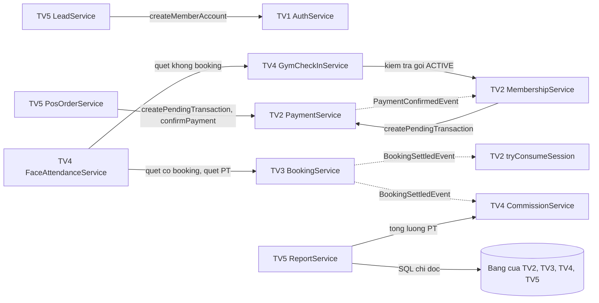
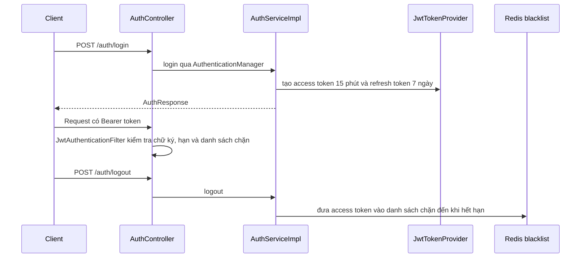
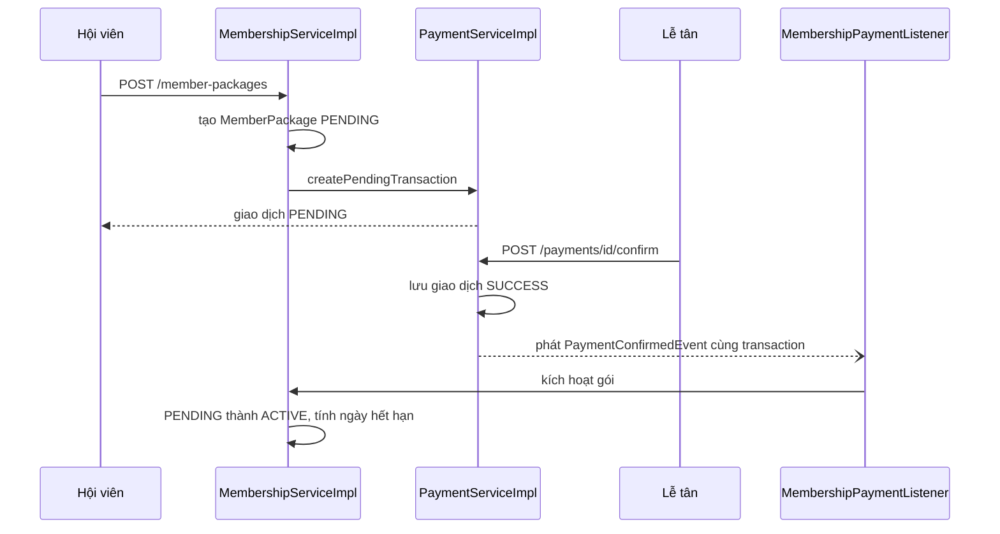
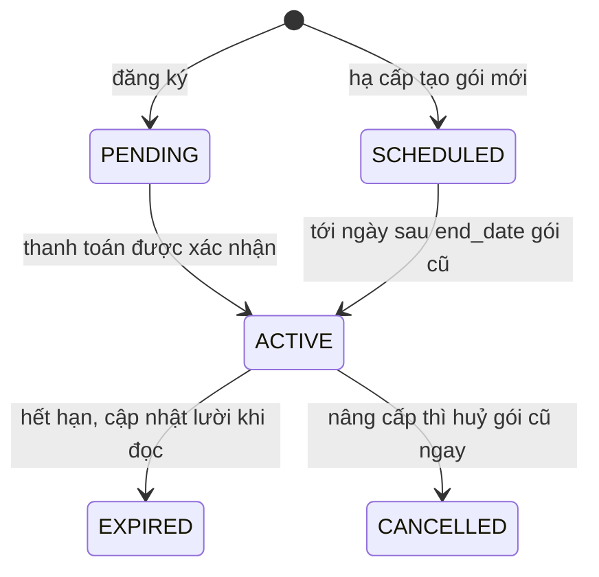
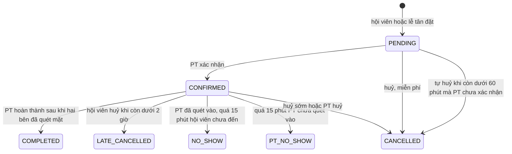
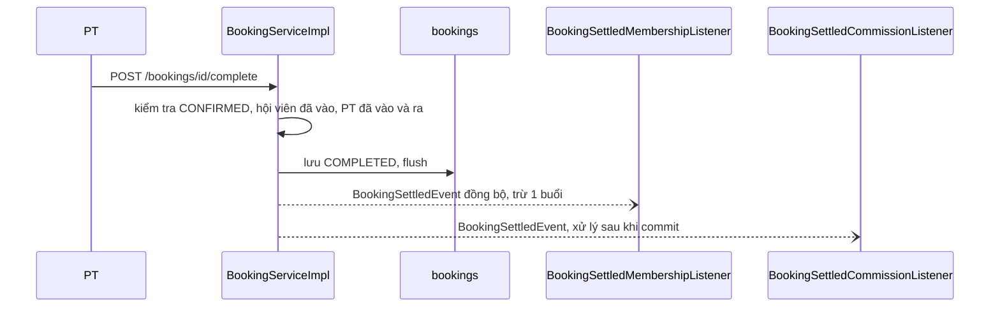
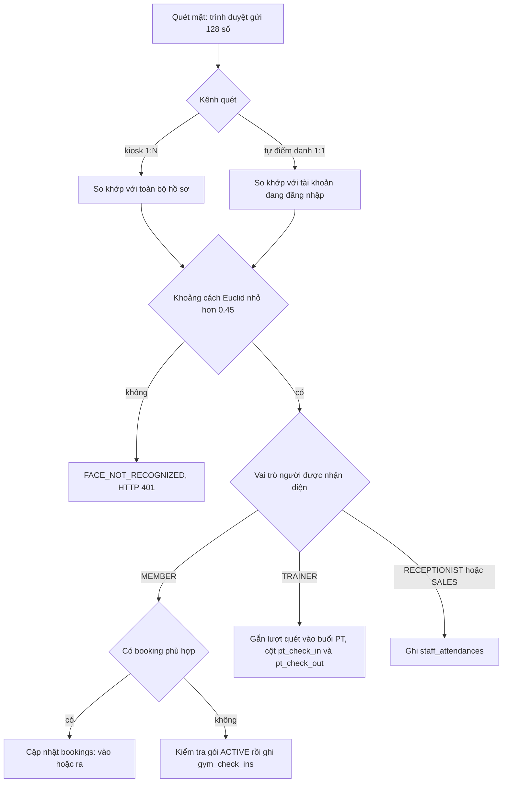
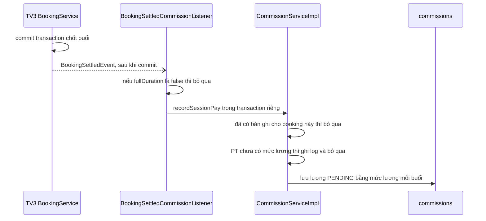
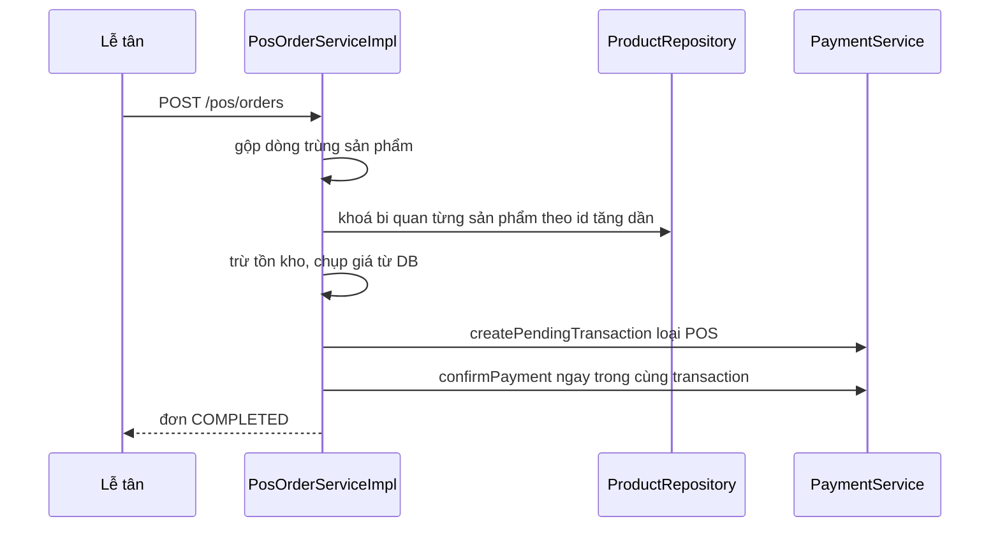
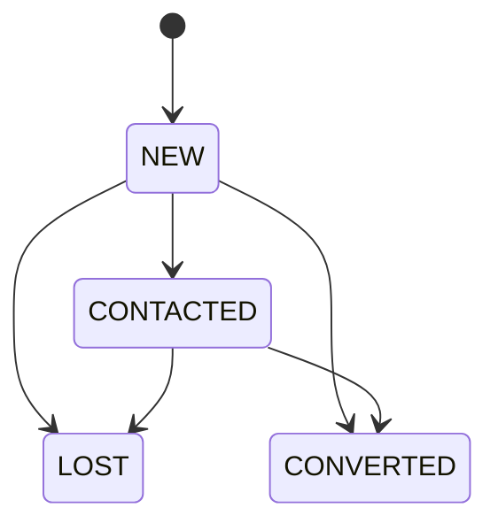

# Phân công backend cho 5 thành viên và luồng hoạt động từng phần

Tài liệu này chia phần backend của Gym Management System cho 5 thành viên, và giải thích **luồng hoạt động** của phần việc mỗi người: request đi qua file nào, dữ liệu ghi vào đâu, phát sự kiện gì, lỗi nào có thể xảy ra.

> **Độ tin cậy.** Viết từ mã trên `master` tại commit `655c61a`: đã đọc controller, service, listener, cấu hình, các tài liệu thay đổi (`CHANGE_PT_ATTENDANCE_AND_PAY.md`, `USER_STORIES.md`, `API_DESIGN.md`) và đếm số liệu từ mã thật. **Chưa chạy từng luồng riêng lẻ** để kiểm chứng. Điểm nào suy ra mà chưa xác minh được ghi *(chưa xác minh)*. Bản này **thay thế** `BACKEND_ARCHITECTURE.md` ở những chỗ đã cũ (xem mục 9).

---

## 1. Cách chia và lý do

Backend có khoảng **10 400 dòng mã chính** và **6 500 dòng test**, gồm 10 mảng nghiệp vụ. Chia theo hai tiêu chí: **khối lượng cân bằng** (mỗi người khoảng 2 000 dòng) và **cùng một nghiệp vụ thì cùng một người** (để người đó hiểu trọn luồng từ đầu đến cuối).

| Mảng | File | Dòng main | File test | Dòng test |
|---|---|---:|---:|---:|
| a. Auth, Hồ sơ, Danh mục (users/trainers/branches) | 43 | 1 504 | 3 | 380 |
| b. Hạ tầng chung (security, config, xử lý lỗi, OpenAPI) | 12 | 728 | 4 | 262 |
| c. Gói tập, Membership, Thanh toán | 31 | 2 002 | 8 | 1 370 |
| d. Lịch PT, Booking | 22 | 1 838 | 4 | 1 458 |
| e. Khuôn mặt, Check-in, Chấm công | 29 | 1 269 | 7 | 1 262 |
| f. POS, Sản phẩm | 17 | 914 | 5 | 847 |
| g. Lương PT (hoa hồng, mức lương/buổi) | 16 | 681 | 1 | 165 |
| h. Leads/CRM | 10 | 632 | 2 | 370 |
| i. Hội viên sắp hết hạn | 4 | 148 | 1 | 102 |
| j. Báo cáo | 8 | 665 | 1 | 314 |

Nhóm lại thành 5 gói việc:

| Thành viên | Gói việc | Mảng | Dòng main | Endpoint |
|---|---|---|---:|---:|
| **TV1** (Backend Lead) | Nền tảng và Định danh | a + b | 2 232 | 10 |
| **TV2** | Gói tập, Thanh toán, Hạn gói | c + i | 2 150 | 17 |
| **TV3** | Lịch PT và Booking | d | 1 838 | 15 |
| **TV4** | Điểm danh, Chấm công, Lương PT | e + g | 1 950 | 15 |
| **TV5** | Bán hàng và Kinh doanh (POS, Leads, Báo cáo) | f + h + j | 2 211 | 22 |

Chênh lệch giữa người nặng nhất và nhẹ nhất khoảng 20%, chấp nhận được vì TV3 gánh luật nghiệp vụ phức tạp nhất (nhiều trạng thái, nhiều điều kiện) còn TV5 nhiều endpoint nhưng mỗi cái đơn giản hơn. Hai điểm đặc biệt:

- **Hội viên sắp hết hạn (mảng i)** giao cho TV2 vì truy vấn SQL đọc thẳng bảng `member_packages` (bảng của TV2): người sở hữu bảng phải là người biết khi nào đổi cột. Đường dẫn `/leads/expiring-soon` vẫn nằm trong `LeadController` (TV5) và gọi sang service của TV2.
- **Lương PT (mảng g)** giao cho TV4 vì lương PT phụ thuộc trực tiếp vào dữ liệu điểm danh (quét mặt vào/ra) của chính TV4. Mảng này chỉ có 1 file test (165 dòng) cho 681 dòng mã nên cần bổ sung test, xem mục 6.

**Họ tên từng người:** TV1 ………… TV2 ………… TV3 ………… TV4 ………… TV5 …………

---

## 2. Ai gọi ai: hợp đồng giữa các thành viên



Nét liền là gọi trực tiếp qua interface, nét đứt là sự kiện nội bộ của Spring. **Không có mũi tên nào đi ngược** nên không có vòng phụ thuộc (có test dựng Spring context để chặn vòng; vòng mới làm `mvn verify` đỏ).

| Điểm nối | Người cung cấp | Người dùng | Hợp đồng |
|---|---|---|---|
| `AuthService.createMemberAccount` | TV1 | TV5 (chuyển lead thành hội viên) | Kiểm tra trùng email và số điện thoại nằm ở TV1; không phát token |
| `PaymentService.createPendingTransaction`, `confirmPayment`, `refundPayment`, `refundByRelated` | TV2 | TV2 (gói), TV5 (POS) | Chữ ký giữ nguyên; mọi thao tác `payment_transactions` đi qua service này |
| `BookingSettledEvent` | TV3 phát | TV2 (trừ buổi), TV4 (tính lương) | 3 kết cục: `COMPLETED`, `MEMBER_NO_SHOW`, `LATE_CANCEL`; **không** phát khi `PT_NO_SHOW` hoặc huỷ thường |
| `PaymentConfirmedEvent` | TV2 phát | TV2 (kích hoạt gói) | Lọc theo `relatedType` |
| `MembershipService.tryConsumeSession`, `getCurrentMembership` | TV2 | TV3, TV4 | `tryConsumeSession` **không ném lỗi nghiệp vụ**, trả kết quả |
| `BookingService` (đọc/cập nhật lượt quét) | TV3 | TV4 | TV4 gọi qua interface, không đụng `BookingRepository` |
| `ExpiringMembershipService.findExpiringSoon` | TV2 | TV5 | Trả danh sách hội viên sắp hết hạn |
| `CommissionService.summarize` | TV4 | TV5 (báo cáo) | Báo cáo không tự query bảng `commissions` |
| File SHARED (`SecurityConfig`, `ErrorCode`, `ApiResponse`, `GlobalExceptionHandler`, `OpenApiConfig`, `pom.xml`, `Jenkinsfile`, `docker-compose*.yml`) | TV1 | Tất cả | Người khác muốn sửa phải qua TV1 |

---

## 3. Quy tắc làm việc chung (mọi thành viên)

**Một PR chỉ được merge khi:**

1. Nhánh tạo từ `origin/master`, PR nhỏ, merge bằng "Create a merge commit".
2. `mvn clean verify` xanh, **gồm các test hợp đồng**: mọi controller có `@Tag` và tên tag nằm trong `OpenApiConfig.TAG_ORDER`; mọi endpoint có `@Operation(summary = ...)`; không endpoint nào trả `ApiResponse<?>` (phải là kiểu cụ thể).
3. Mọi "bây giờ" lấy từ bean `Clock`, không dùng `LocalDateTime.now()` trần.
4. Lỗi nghiệp vụ ném `BusinessException` kèm `ErrorCode`; thêm mã lỗi mới phải qua TV1.
5. Đổi API thì cập nhật `API_DESIGN.md` cùng PR.
6. **Migration:** thêm file mới, không sửa file đã merge. Migration đụng dữ liệu cũ phải chạy thử trên **DB trống** và trên **bản sao dữ liệu thật** (`gms_db_ci`). Kiểm tra dữ liệu mồ côi trước khi thêm khoá ngoại.
7. **Seed** trong `scripts/dev-seed/`: chạy lại không lỗi, tham chiếu người dùng theo email, bật `SET QUOTED_IDENTIFIER ON;`, số điện thoại không trùng (`00_users` dùng `0911000xxx`, seed 60 dùng `09000000xx`).
8. Trước khi mở PR: `check_prs.ps1 -Simulate -Verify` (thêm `-Migrate` nếu có migration). Sau khi merge: chờ Jenkins xanh rồi mới merge PR kế tiếp.

**Những lỗi đã xảy ra thật trong dự án, đừng lặp lại:**

| Sự cố | Nguyên nhân gốc | Cách tránh |
|---|---|---|
| Jenkins không khởi động sau khi merge V7 | `gms_db_ci` có 3 giao dịch POS mồ côi, khoá ngoại thất bại | Kiểm tra dữ liệu cũ trước migration có khoá ngoại |
| Build đỏ sau khi merge hai PR hợp lệ (Swagger) | Test yêu cầu tag mới nằm trong `TAG_ORDER` | Controller mới thì thêm tag vào `TAG_ORDER` cùng PR |
| Build đỏ sau khi merge hai PR hợp lệ (`ApiResponse<?>`) | Test hợp đồng cấm kiểu wildcard | Luôn dùng kiểu cụ thể |
| Seed trong Docker lỗi `QUOTED_IDENTIFIER` | `sqlcmd` trên Linux mặc định tắt tuỳ chọn này, mà `users` có filtered index | `SET QUOTED_IDENTIFIER ON;` đầu file seed |
| Seed lỗi trùng `uq_users_phone` | Hai seed dùng cùng số điện thoại | Mỗi seed một dải số riêng |
| Thiếu tham số bắt buộc trả 500 | Handler cuối `Exception.class` nuốt lỗi của Spring | Đã thêm handler trả 400 `VALIDATION_ERROR` |

---

## 4. TV1: Nền tảng và Định danh

**Mục tiêu:** ai đăng nhập được, ai gọi được endpoint nào, lỗi trả về dạng gì, và hệ thống được build, kiểm tra, triển khai ra sao. TV1 cũng là người duyệt các thay đổi file SHARED và thứ tự merge.

**File chính:** `AuthController`, `ProfileController`, `UserController`, `TrainerController`, `BranchController`; `AuthService`, `ProfileService`, `DirectoryService`; `UserRepository`, `RoleRepository`, `UserProfileRepository`, `BranchRepository`, `UserDirectoryRepository`; `security/*` (JWT, bộ lọc, `RestAuthenticationEntryPoint`, `RestAccessDeniedHandler`); `config/*` (`SecurityConfig`, `OpenApiConfig`); `exception/*`; migration V1, V2.1, V9; `Jenkinsfile`, `Dockerfile`, `docker-compose*.yml`.

### 4.1 Xác thực và JWT



- **Đăng ký** chỉ tạo tài khoản `MEMBER`, kiểm tra trùng email và số điện thoại (`AUTH_EMAIL_ALREADY_EXISTS`, `AUTH_PHONE_ALREADY_EXISTS`). Số điện thoại trống lưu `NULL`; nhiều tài khoản không có số được phép nhờ filtered unique index (V9).
- Nhân viên (lễ tân, PT, sales, admin) **không tự đăng ký**, được cấp qua dữ liệu.
- `refresh` nhận `refreshToken` dạng tham số, không nhận JSON.
- Đăng nhập sai trả 401 `AUTH_INVALID_CREDENTIALS`; thiếu hoặc hết hạn token trả 401 `AUTH_TOKEN_INVALID` (JSON, do `RestAuthenticationEntryPoint`); đủ đăng nhập nhưng sai vai trò trả 403 `AUTH_FORBIDDEN_ROLE` (do `RestAccessDeniedHandler` hoặc `@PreAuthorize`).

### 4.2 Chuẩn lỗi toàn hệ thống

| Tình huống | HTTP | `errorCode` |
|---|---|---|
| `BusinessException` | theo `ErrorCode` | theo `ErrorCode` |
| Dữ liệu vào sai (`@Valid`, JSON hỏng, sai kiểu tham số) | 400 | `VALIDATION_ERROR` |
| **Thiếu tham số bắt buộc trên query** | 400 | `VALIDATION_ERROR` |
| Sai email hoặc mật khẩu | 401 | `AUTH_INVALID_CREDENTIALS` |
| Chưa đăng nhập hoặc token hết hạn | 401 | `AUTH_TOKEN_INVALID` |
| Sai vai trò | 403 | `AUTH_FORBIDDEN_ROLE` |
| Vi phạm unique hoặc khoá ngoại ở DB | 409 | `DATA_CONFLICT` |
| Lỗi không lường trước | 500 | `INTERNAL_SERVER_ERROR` |

Mọi response bọc trong `ApiResponse { success, message, data, errorCode, timestamp }`.

### 4.3 Hồ sơ và danh mục

- **Hồ sơ:** `GET/PUT /profile/me`, `POST /profile/me/avatar` (tệp tên `image`, lưu vào thư mục `uploads/`, phục vụ qua `/uploads/**`). Ngày sinh: từ **18 tuổi trở lên tính đến ngày đăng ký** và không quá 120 tuổi, sai trả `PROFILE_INVALID_AGE`.
- **Danh mục chỉ đọc** (`DirectoryService`): `GET /users?role=MEMBER&q=` (**Lễ tân và Admin**, vì trả cả số điện thoại và email; chỉ hội viên `ACTIVE`; tìm theo tên, số điện thoại hoặc email; tối đa 50 dòng mỗi trang, từ khoá cắt ở 100 ký tự, ký tự đặc biệt của `LIKE` được thoát bằng `!`); `GET /trainers` (mọi người đã đăng nhập; chỉ trả id, tên, ảnh); `GET /branches` (chi nhánh `ACTIVE`, sắp theo tên).

### 4.4 Build, kiểm tra, triển khai

- **Jenkins** pipeline `GMS-CICD`: Checkout, Restore, Build, Test, Publish, Deploy, Verify. Mỗi lần merge vào `master` tự chạy. Deploy chép jar vào `C:\deploy\gms`, chạy bằng Windows service `GymManagementSystem`, cổng 8081, database `gms_db_ci`. Verify gọi `/v3/api-docs` mong 200.
- **Docker demo:** `docker compose -f docker-compose.demo.yml up -d --build` dựng SQL Server, Redis, backend, frontend và nạp dữ liệu mẫu; web 3000, API 8082. Kiểm thử nhanh bằng `scripts\demo-smoke.ps1`.

### 4.5 Việc của TV1
- Duyệt mọi PR đụng file SHARED, quyết định thứ tự merge, chạy mô phỏng trước khi merge.
- Cập nhật `BACKEND_ARCHITECTURE.md` theo mục 9.
- Kiểm chứng lỗi 404, 405, 415 có bị biến thành 500 không (xem mục 8).

**Câu hỏi hay gặp khi bảo vệ:** Vì sao dùng JWT không lưu session? (Stateless, mở rộng ngang dễ; đổi lại phải có danh sách chặn khi đăng xuất, lưu ở Redis.) Làm sao đăng xuất vô hiệu hoá token đang còn hạn? (Đưa vào danh sách chặn Redis đến khi hết hạn.) Vì sao `/users` không cho PT dùng? (Trả số điện thoại và email của hội viên, là dữ liệu riêng tư.)

---

## 5. TV2: Gói tập, Thanh toán, Hạn gói

**Mục tiêu:** hội viên mua được gói, thanh toán được xác nhận, gói được kích hoạt đúng hạn, số buổi trừ đúng, và biết ai sắp hết hạn.

**File chính:** `PackageController`, `MembershipController`, `PaymentController`; `PackageService`, `MembershipService`, `PaymentService`, `ExpiringMembershipService`; `PackageRepository`, `MemberPackageRepository`, `PaymentTransactionRepository`, `ExpiringMemberRepository`; `MembershipPaymentListener`, `BookingSettledMembershipListener`, `PaymentConfirmedEvent`; migration V2, V2.2, V7.

### 5.1 Mua gói và kích hoạt



- **Hạn gói:** `end_date = start_date + duration_days - 1` (tính cả ngày cuối). Hội viên đã có gói thì gói mới bắt đầu ngay sau `end_date` của gói cũ.
- **`PaymentServiceImpl` không gọi `MembershipService`**, chỉ phát sự kiện. Đây là cách gỡ vòng phụ thuộc cũ. Listener chạy chung transaction để xác nhận thanh toán và kích hoạt gói thành công hoặc thất bại cùng nhau.
- Chặn đăng ký mới nếu hội viên đang có gói `PENDING`.

### 5.2 Vòng đời gói và nâng/hạ cấp



- **Nâng cấp** (`POST /member-packages/{id}/upgrade`): gói mới phải có giá lớn hơn hoặc bằng gói hiện tại; gói cũ bị **huỷ ngay**, không chờ thanh toán; tạo gói mới `PENDING` và giao dịch chờ.
- **Hạ cấp** (`.../downgrade`): gói cũ **giữ nguyên**, tạo gói mới `SCHEDULED` bắt đầu ngày sau `end_date` của gói cũ.
- **Hết hạn là cập nhật lười** (không có job nền): trạng thái chỉ đổi khi bản ghi được đọc. `getCurrentMembership` là nguồn chân lý duy nhất cho "gói hiện tại".

### 5.3 Trừ buổi

`BookingSettledMembershipListener` (`@EventListener`, đồng bộ, chung transaction với TV3) gọi `MembershipService.tryConsumeSession(memberId)` cho cả 3 kết cục `COMPLETED`, `MEMBER_NO_SHOW`, `LATE_CANCEL`. Hàm này **không ném lỗi nghiệp vụ**: nếu không có gói `ACTIVE` hoặc hết buổi thì chỉ ghi log cảnh báo, để không làm hỏng transaction chốt buổi của TV3.

### 5.4 Hoàn tiền

- `refundPayment(transactionId)` và `refundByRelated(relatedType, relatedId)`: đổi giao dịch `SUCCESS` sang `REFUNDED`. Gọi lại cho giao dịch đã hoàn thì trả kết quả cũ, không hoàn lần hai (idempotent).
- **Chỉ hoàn giao dịch POS đã thu tiền.** Gói tập chưa hỗ trợ hoàn (gói có thể đã dùng). Giao dịch không phải POS hoặc chưa `SUCCESS`, hoặc đơn POS không có giao dịch nào, đều trả `PAYMENT_NOT_REFUNDABLE`; `relatedType` lạ trả `VALIDATION_ERROR`. `refundByRelated` lấy giao dịch mới nhất của đơn POS.
- Báo cáo doanh thu chỉ cộng `SUCCESS` nên tự loại giao dịch `REFUNDED`.
- ⚠️ **Chưa được nối với POS**, xem mục 8.

### 5.5 Hội viên sắp hết hạn

`ExpiringMemberRepository` là SQL thuần: lấy gói `ACTIVE` có `end_date` trong khoảng, của hội viên còn hoạt động, **bỏ những người đã có gói `ACTIVE` hoặc `SCHEDULED` kết thúc muộn hơn** (đã gia hạn). Sắp theo ngày hết hạn tăng dần. Vì là SQL thuần đọc bảng `member_packages`, **đổi cột bảng này phải sửa truy vấn này và chạy lại `ExpiringMembershipServiceImplTest`.**

**Câu hỏi hay gặp khi bảo vệ:** Vì sao dùng sự kiện thay vì gọi trực tiếp giữa Payment và Membership? (Hai bên từng inject lẫn nhau gây vòng phụ thuộc bean.) Vì sao hết hạn kiểm tra khi đọc thay vì chạy job nền? (Đơn giản hơn, không cần bộ lập lịch; đổi lại trạng thái chỉ cập nhật khi có ai đọc.) Nâng cấp khác hạ cấp thế nào? (Nâng: gói cũ bị huỷ ngay, gói mới chờ thanh toán. Hạ: giữ gói cũ đến hết hạn rồi mới chuyển sang gói mới.)

---

## 6. TV3: Lịch PT và Booking

**Mục tiêu:** PT đăng ký ca làm, hội viên đặt buổi trong ca đó, PT xác nhận và hoàn thành, hệ thống chốt kết cục đúng và báo cho TV2, TV4.

**File chính:** `ScheduleController`, `BookingController`; `TrainerScheduleService`, `BookingService`/`BookingServiceImpl`; `TrainerScheduleRepository`, `BookingRepository`; `BookingSettledEvent`; migration V3.

### 6.1 Vòng đời một buổi tập



Cấu hình (`application.yml`, khoá `gms.booking`): `min-lead-minutes: 30`, `slot-duration-minutes: 60`, `pending-cancel-threshold-minutes: 60`, `no-show-grace-minutes: 15`, `late-cancel-hours: 2`.

### 6.2 Đặt lịch (`POST /bookings`)

Người đặt: `MEMBER` (tự đặt) hoặc `RECEPTIONIST`/`SUPER_ADMIN` (đặt hộ, truyền `memberId`). Hệ thống kiểm tra các điều kiện sau (thứ tự thực hiện trong mã chưa được xác minh):

1. Trong ca làm việc của PT, nếu không thì `BOOKING_OUT_OF_WORKING_HOURS`.
2. Cách giờ hiện tại ít nhất 30 phút, nếu không thì `BOOKING_TOO_SOON`.
3. Khung giờ chưa có ai đặt, nếu không thì `BOOKING_SLOT_TAKEN` (409).
4. Hội viên không trùng giờ với PT khác, nếu không thì `BOOKING_DOUBLE_BOOKED`.
5. Không vượt giới hạn buổi mỗi tuần theo gói, nếu không thì `BOOKING_WEEKLY_LIMIT_EXCEEDED`.
6. Gói còn hạn và còn buổi (`MEMBERSHIP_EXPIRED`, hết buổi).

Slot trống và danh sách PT còn slot: `GET /trainer-schedules/available?trainerId&date`, `GET /trainer-schedules/trainers?date=` (**`date` bắt buộc**, thiếu trả 400).

### 6.3 Chốt buổi và sự kiện



- Điều kiện hoàn thành: booking `CONFIRMED`, hội viên đã quét vào, PT đã quét **vào và ra** (`BOOKING_NOT_CHECKED_IN`, `BOOKING_PT_NOT_CHECKED_IN`). PT ra trước giờ kết thúc phải nộp lý do (`PUT /bookings/{id}/early-leave-reason`, tối thiểu 5 ký tự); không có lý do thì buổi vẫn `COMPLETED` nhưng `fullDuration = false` và PT **không được tính lương**.
- Sự kiện chỉ phát cho 3 kết cục: `COMPLETED`, `MEMBER_NO_SHOW`, `LATE_CANCEL`. **Không phát** cho `PT_NO_SHOW` và huỷ thường (không trừ buổi, không trả công).
- **Chống xử lý trùng:** cột `bookings.version` kèm `@Version` (khoá lạc quan); `flush()` gọi **trước** `publishEvent`. Hai request đồng thời lên cùng booking thì một cái thắng, cái kia nhận 400 `VALIDATION_ERROR`.
- **Trạng thái tự chuyển khi đọc** (lazy-status), không có job nền: buổi `PENDING` mà còn dưới 60 phút (`pending-cancel-threshold-minutes`) tới giờ bắt đầu thì thành `CANCELLED`; buổi `CONFIRMED` quá giờ ân hạn 15 phút thì thành `PT_NO_SHOW` (PT chưa quét vào) hoặc `NO_SHOW` (PT đã quét vào, hội viên chưa đến). Tất cả chỉ xảy ra khi booking được đọc.
- PT được quét mặt trong khoảng từ 30 phút trước giờ bắt đầu đến 15 phút sau.
- Huỷ: hội viên huỷ buổi `PENDING` luôn miễn phí; huỷ buổi `CONFIRMED` còn dưới 2 giờ là `LATE_CANCELLED` (mất 1 buổi, PT vẫn được trả công); PT huỷ thì `CANCELLED`, không trừ buổi, không lương. Lễ tân và admin huỷ hộ cũng áp quy tắc 2 giờ.

**Câu hỏi hay gặp khi bảo vệ:** Vì sao dùng khoá lạc quan? (Chặn hai request đồng thời cùng chốt một buổi mà không cần khoá bi quan.) Vì sao `flush()` trước khi phát sự kiện? (Để lỗi xung đột phiên bản nổ ra trước khi các listener kịp trừ buổi hay tính lương.) Ai được đặt lịch? (Hội viên và lễ tân; PT chỉ xác nhận và hoàn thành. Nếu muốn PT tự tạo buổi là yêu cầu mới, xem mục 8.)

---

## 7. TV4: Điểm danh, Chấm công, Lương PT

**Mục tiêu:** nhận diện khuôn mặt để ghi lượt vào/ra đúng người đúng vai trò, rồi tính lương PT từ buổi đã chốt.

**File chính:** `FaceProfileController`, `FaceAttendanceController`, `StaffAttendanceController`, `CheckInController`, `CommissionController`, `TrainerPayRateController`; `FaceProfileService`, `FaceAttendanceService`, `StaffAttendanceService`, `GymCheckInService`, `CheckInHistoryService`, `CommissionService`, `TrainerPayRateService`; `FaceMatchService` (`integration/hardware`); `BookingSettledCommissionListener`; migration V4, V8 và phần `commissions`, `trainer_pay_rates` của V5.

### 7.1 Quét mặt



- **Đăng ký khuôn mặt:** trình duyệt dùng face-api.js trích 128 số và gửi `{ "descriptor": [...] }`; **không gửi ảnh gốc**. Sai độ dài thì `FACE_DESCRIPTOR_INVALID`. Đăng ký lại ghi đè. `GET /face-profiles/me` cho biết đã đăng ký chưa.
- **Vào/ra thông minh:** không cần chọn trước; lần quét đầu là vào, lần sau là ra. PT gắn vào từng buổi theo khung giờ.
- **Chống quét đúp:** khoá Redis; hội viên 120 giây (`min-scan-interval-seconds`), PT 15 giây (PT dạy hai buổi liền nhau không bị chặn).
- **`gym_check_ins` (V8)** chỉ ghi lượt vào **không có booking**; lượt có buổi PT chỉ cập nhật `bookings`. Hai nguồn loại trừ nhau nên tổng lưu lượng là tổng hai nguồn, không đếm trùng. Lượt vào cần gói `ACTIVE` (`MEMBERSHIP_NOT_FOUND` hoặc `MEMBERSHIP_EXPIRED`); lượt ra không kiểm tra gói.
- **Chấm công nhân viên:** lễ tân và sales; ca mặc định 07:00 đến 21:00 (`default-shift-start/end`); trạng thái `ON_TIME`, `LATE`, `LATE_AND_LEFT_EARLY`. PT **không** ghi `staff_attendances` vì được trả theo buổi.
- `FACE_NOT_RECOGNIZED` trả **401** dù người dùng đã đăng nhập, nên frontend phân biệt theo `errorCode`.

### 7.2 Từ buổi đã chốt đến lương PT



- Listener chạy `AFTER_COMMIT` và ghi lương trong transaction **riêng** (`REQUIRES_NEW`), và nuốt mọi lỗi: lỗi tính lương **không bao giờ** được làm hỏng việc chốt buổi của PT. Đổi lại, nếu có lỗi thì phải xử lý bù thủ công (log ghi rõ).
- **Chống trùng theo thiết kế (idempotent)**: kiểm tra `existsByBookingId` thay vì dựa vào ngoại lệ unique.
- **Chỉ PT được trả lương theo buổi.** Lương = `amount_per_session` của PT tại thời điểm ghi nhận.
- ⚠️ **PT chưa được đặt mức lương thì không có dòng lương nào được tạo**, chỉ có một dòng log cảnh báo. Đây là lý do danh sách lương rỗng khi mới demo: Admin phải đặt mức lương (`PUT /trainer-pay-rates/{trainerId}`) **trước** khi PT chốt buổi; theo mã, lương chỉ được ghi khi nhận sự kiện chốt buổi nên các buổi chốt trước đó **không được tính bù tự động** (nếu cần phải xử lý thủ công).
- Admin tra cứu `GET /commissions?...` theo PT và tháng, đánh dấu đã trả bằng `POST /commissions/{id}/mark-paid` (`PENDING` sang `PAID`). PT xem của mình ở `GET /commissions/me`.

### 7.3 Việc của TV4
- Bổ sung test cho phần lương: idempotent, PT chưa có mức lương, `mark-paid` chuyển trạng thái, lọc theo tháng (hiện chỉ 1 file test, 165 dòng).
- Kiểm chứng ngưỡng khớp mặt 0.45 với khuôn mặt thật.

**Câu hỏi hay gặp khi bảo vệ:** Vì sao gửi vector 128 số thay vì ảnh? (Riêng tư và nhẹ; không lưu ảnh khuôn mặt.) Vì sao tính lương sau khi commit trong transaction riêng? (Lỗi tính lương không được làm hỏng buổi tập đã chốt.) Vì sao PT không có dòng chấm công? (PT trả theo buổi, không theo giờ làm.)

---

## 8. TV5: Bán hàng và Kinh doanh (POS, Leads, Báo cáo)

**Mục tiêu:** bán hàng tại quầy đúng tồn kho và đúng tiền, quản lý khách tiềm năng, và cung cấp báo cáo cho quản trị viên.

**File chính:** `PosController`, `ProductController`, `LeadController`, `ReportController`; `PosOrderService`, `ProductService`, `LeadService`, `ReportService`; `PosOrderRepository`, `ProductRepository`, `LeadRepository`, `ReportRepository` (SQL thuần chỉ đọc); migration V5 (phần POS), V6.

### 8.1 Bán hàng tại quầy



- **Khoá theo thứ tự id tăng dần**: nếu hai đơn cùng bán sản phẩm A và B mà khoá theo thứ tự khách chọn thì khoá chéo nhau và SQL Server giết một đơn (deadlock). Khoá giữ đến hết transaction nên hai đơn không cùng đọc tồn kho cũ.
- **Giá lấy từ DB**, không tin giá client gửi lên. Bán tại quầy là thu tiền ngay, không có bước chờ xác nhận như gói tập. `user` của giao dịch là **người mua** (null nếu khách vãng lai); nhân viên thu tiền lưu ở `pos_orders.staff_id`.
- **Huỷ đơn** (`POST /pos/orders/{id}/cancel`): chỉ huỷ đơn đã `COMPLETED`, trả lại tồn kho, huỷ lại thì không lỗi (idempotent).
- ⚠️ **Huỷ đơn hiện chưa hoàn tiền** (xem mục 9, việc tồn đọng số 1).
- Sản phẩm: "xoá" là ngừng bán (`is_active = false`), không xoá bản ghi.

### 8.2 Leads/CRM



- `LOST` và `CONVERTED` là trạng thái cuối. Chuyển sai trả `LEAD_INVALID_STATUS_TRANSITION`.
- **Quyền xem:** Super Admin thấy tất cả; Sales chỉ thấy lead của mình hoặc lead chưa gán, và thao tác lên lead chưa gán thì tự nhận. Lead của Sales khác trả **404 (không phải 403)** để không lộ sự tồn tại.
- **Chuyển thành hội viên** (`POST /leads/{id}/convert`): khoá dòng lead, gọi `AuthService.createMemberAccount` (TV1) **cùng transaction** (lưu lead lỗi thì tài khoản cũng rollback), đánh dấu `CONVERTED`. Không sinh hoa hồng. Không gửi mật khẩu thì sinh ngẫu nhiên (bỏ ký tự dễ nhầm như 0/O, 1/l/I) và trả `temporaryPassword` **một lần**, không ghi log.
- Số điện thoại chuẩn hoá `+84xxxxxxxxx` hoặc `84xxxxxxxxx` về `0xxxxxxxxx` để so khớp trùng. Tạo lead trùng số vẫn được tạo, response có `duplicatePhone`.
- `GET /leads/expiring-soon` gọi `ExpiringMembershipService` của TV2.

### 8.3 Báo cáo (chỉ Super Admin)

| Báo cáo | Nguồn dữ liệu |
|---|---|
| `revenue` | `payment_transactions` trạng thái `SUCCESS`, theo ngày hoặc tháng, **tách `membership` và `pos`** |
| `renewal-rate` | `member_packages` theo `end_date`, đếm gói hết hạn và gói được gia hạn trong cửa sổ `windowDays` |
| `checkin-traffic` | `bookings.check_in_time` cộng `gym_check_ins` |
| `top-packages` | giao dịch `MEMBERSHIP` `SUCCESS`, nhóm theo gói |
| `commissions-summary` | **gọi `CommissionService.summarize`** (không tự query bảng `commissions`) |

Khoảng ngày mặc định từ mùng 1 của tháng đến hôm nay, tối đa 366 ngày, theo giờ Việt Nam. `ReportRepository` là SQL thuần đọc bảng của nhiều module, nên **bất kỳ ai đổi cột bảng mà báo cáo đọc phải báo TV5** và chạy lại `ReportServiceImplTest`.

**Câu hỏi hay gặp khi bảo vệ:** Vì sao khoá sản phẩm theo id tăng dần? (Tránh deadlock khi hai đơn khoá chéo.) Vì sao lead của người khác trả 404? (Không lộ sự tồn tại dữ liệu.) Vì sao báo cáo viết bằng SQL thuần? (Truy vấn tổng hợp nhiều bảng, chỉ đọc, hiệu quả hơn qua JPA; đổi lại phải theo dõi thay đổi schema.)

---

## 9. Việc tồn đọng của backend (đã có người phụ trách)

| # | Việc | Chủ | Mô tả và hành động |
|---|---|---|---|
| 1 | **Huỷ đơn POS chưa hoàn tiền** | TV5 sửa, TV2 hỗ trợ | `PaymentService.refundByRelated("POS", orderId)` đã có và có test, nhưng `PosOrderServiceImpl.cancelOrder` **không gọi** nó (mình đã tìm trong mã: không có nơi nào gọi ngoài test). Hậu quả: huỷ đơn trả lại tồn kho nhưng giao dịch vẫn `SUCCESS`, doanh thu vẫn tính. Cần gọi hoàn tiền trong `cancelOrder`, cùng transaction, thêm test |
| 2 | Kiểm tra lỗi 404, 405, 415 | TV1 | Handler cuối `Exception.class` có thể biến các lỗi này thành 500 *(chưa xác minh)*. Thử gọi đường dẫn không tồn tại khi đã đăng nhập; nếu ra 500 thì xử lý như đã làm với thiếu tham số |
| 3 | PT tạo buổi cho hội viên (story T15) | TV3 (chờ quyết định) | Không có trong thiết kế hiện tại (`USER_STORIES.md` T1 đến T14, `API_DESIGN.md` dòng đặt lịch). Chỉ làm nếu đề bài yêu cầu. Kéo theo: trạng thái ban đầu của buổi, cách PT tìm hội viên (`/users` đang chỉ cho Lễ tân và Admin vì lý do riêng tư, cần TV1 duyệt), áp lại luật gói và giới hạn tuần |
| 4 | Bổ sung test cho lương PT | TV4 | Xem mục 7.3 |
| 5 | Cập nhật `BACKEND_ARCHITECTURE.md` | TV1 | Danh sách chỗ cũ ở dưới |
| 6 | Cập nhật `API_DESIGN.md` cho `GET /face-profiles/me` | TV4 | Bảng hiện chỉ ghi `POST` |

### Những chỗ `BACKEND_ARCHITECTURE.md` đã cũ

1. V5, V7, V8 **đã vào `master`**; POS, sản phẩm, hoa hồng, mức lương PT đã có (`PosController`, `ProductController`, `CommissionController`, `TrainerPayRateController`). Mục 6, 7.8, 9, 11 cần viết lại.
2. Người chưa đăng nhập hiện nhận **401 JSON** (`RestAuthenticationEntryPoint`, `RestAccessDeniedHandler`); `/users`, `/trainers`, `/branches` **đã có**.
3. Listener lương PT chạy **sau commit, trong transaction riêng** (`AFTER_COMMIT` kèm `REQUIRES_NEW`), không phải cùng transaction như bảng sự kiện đang ghi. Hai listener còn lại (`MembershipPaymentListener`, `BookingSettledMembershipListener`) vẫn đồng bộ, cùng transaction.
4. Thư mục thật của listener là `service/listener/` (không phải `service/event/`).
5. Nâng cấp gói **huỷ gói cũ ngay**; hạ cấp tạo gói `SCHEDULED`. Báo cáo `revenue` **tách `membership` và `pos`**; `commissions-summary` đã có, đọc qua `CommissionService`; truy vấn báo cáo không còn dùng `related_type` (V7 đã tách thành hai khoá ngoại).
6. Thêm hai **test hợp đồng**: `OpenApiDocumentationTest` (tag và `@Operation`) và `ApiResponseContractTest` (cấm `ApiResponse<?>`).
7. Thêm **Docker demo** (`docker-compose.demo.yml`) và `scripts/demo-smoke.ps1` vào mục hạ tầng.

---

## 10. Cách tự kiểm tra phần việc của mình

Chạy bộ Docker demo, rồi chạy kiểm thử khói theo vai trò:

```powershell
docker compose -f docker-compose.demo.yml up -d --build
.\scripts\demo-smoke.ps1
```

Tài khoản mẫu (`docs/TEST_ACCOUNTS.md`, mật khẩu chung `Gym@12345`): `admin@gym.test`, `reception@gym.test`, `sales@gym.test`, `trainer1@gym.test`, `trainer2@gym.test`, `member.active@gym.test`, `member.nopackage@gym.test`, `member.expired@gym.test`. Swagger: `http://localhost:8082/swagger-ui.html`.

| Thành viên | Thử gì để biết phần mình chạy đúng |
|---|---|
| TV1 | Đăng nhập đủ 6 vai trò; gọi `/users` bằng member phải 403, không token phải 401; thiếu tham số bắt buộc phải 400 |
| TV2 | Hội viên đăng ký gói, lễ tân xác nhận thanh toán, gói chuyển `ACTIVE`; nâng cấp thì gói cũ `CANCELLED`; `/leads/expiring-soon` trả đúng người |
| TV3 | PT tạo ca, hội viên đặt vào ca, PT xác nhận; đặt trùng giờ phải `BOOKING_SLOT_TAKEN`; đặt sát giờ phải `BOOKING_TOO_SOON` |
| TV4 | Đăng ký khuôn mặt rồi quét; Admin đặt mức lương PT, PT hoàn thành buổi đã quét đủ, dòng lương xuất hiện ở `GET /commissions` |
| TV5 | Tạo đơn POS và kiểm tra tồn kho giảm; huỷ đơn và kiểm tra tồn kho tăng lại (và sau khi sửa việc số 1, giao dịch thành `REFUNDED`); chuyển lead qua các trạng thái; mở báo cáo doanh thu |

---

## 11. Mục tiêu bổ sung test (đo bằng JaCoCo ngày 08/11/2026)

Đo trên `master` cộng bản có JaCoCo: **độ phủ lệnh toàn dự án 70%** (9 660 lệnh sau khi loại `dto`, `entity`, `config` như cấu hình SonarQube sẽ làm). Cột "Chưa phủ" là số lệnh bytecode chưa được test chạy tới; lớp có số này lớn và tỉ lệ thấp là nơi bổ sung test được lợi nhất.

| Gói | Chưa phủ | Tỉ lệ |
|---|---:|---:|
| `service/impl` | 1 415 | 80% |
| `controller` | 752 | 12% |
| `security` | 374 | 9% |
| `repository` | 210 | 27% |
| `exception` | 132 | 76% |

Tầng service khá tốt; **controller và security gần như chưa có test**. Việc kiểm tra quyền (200, 401, 403) hiện chỉ do `scripts/demo-smoke.ps1`, là kiểm thử tích hợp chạy tay chứ không chạy trong Jenkins.

| Thành viên | Lớp nên bổ sung test | Chưa phủ | Tỉ lệ | Gợi ý |
|---|---|---:|---:|---|
| TV1 | `JwtTokenProvider` | 103 | 0% | Ưu tiên số 1: lớp bảo mật mà chưa có test. Kiểm tra tạo token, đọc claim, token hết hạn, token bị sửa, sai chữ ký |
| TV1 | `ProfileController` | 105 | 0% | Test lát cắt web kiểm tra đường dẫn và quyền |
| TV1 | `AuthServiceImpl` | 138 | 38% | Đăng ký trùng email hoặc số điện thoại, đăng xuất đưa token vào danh sách chặn |
| TV1 | `GlobalExceptionHandler` | 121 | 21% | Mỗi loại ngoại lệ một test (đã có file test khởi đầu) |
| TV2 | `MembershipController` | 162 | 9% | Đường dẫn và quyền của 7 endpoint |
| TV2 | `PackageServiceImpl` | 120 | 39% | Tạo, sửa, xoá mềm, giá và thời hạn không hợp lệ |
| TV2 | `MembershipServiceImpl` | 183 | 72% | Nhánh nâng cấp và hạ cấp |
| TV3 | `TrainerScheduleServiceImpl` | 262 | 44% | Lớp thiếu test lớn nhất: ca chồng giờ, sửa và xoá ca đã có người đặt |
| TV3 | `BookingController` | 79 | 0% | Đường dẫn và quyền |
| TV4 | `TrainerPayRateServiceImpl` | 71 | 0% | Đặt mức lương, đổi mức, giá trị không hợp lệ |
| TV5 | `ReportRepository` | 152 | 0% | SQL thuần nên test dịch vụ chỉ giả lập nó. Hiện được kiểm chứng gián tiếp qua smoke test trên DB thật; muốn test thật cần SQL Server (Testcontainers), cân nhắc chi phí |
| TV5 | `LeadServiceImpl` | 143 | 73% | Các nhánh chuyển trạng thái và quyền xem |

**Mục tiêu đề xuất:** đạt ít nhất 75% ở lần quét kế tiếp. Mười lớp đầu bảng trên còn khoảng 1 500 lệnh chưa phủ; chỉ cần phủ thêm khoảng 1 000 lệnh trong tổng số 9 660 là đạt 80%. Mỗi người cần xử lý lớp ưu tiên của mình, rồi chạy lại `scripts\sonar-analyze.ps1` để xem tiến độ.

**Lưu ý:** mức "Coverage" trên SonarQube gộp độ phủ dòng và nhánh nên thường thấp hơn con số 70% (độ phủ lệnh) ở đây vài điểm.
