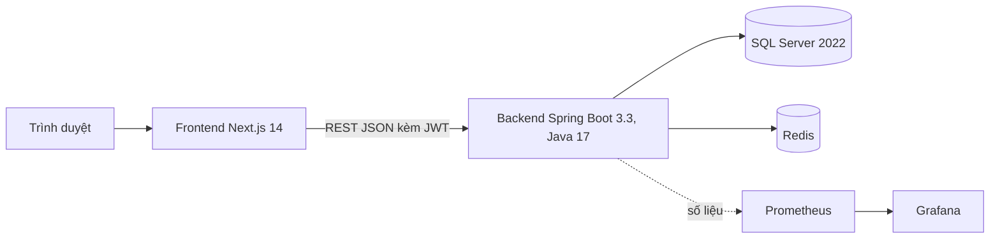
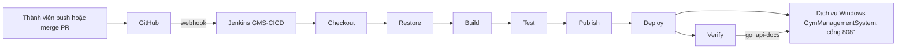

# Tổng kết dự án Gym Management System (GMS) cho người viết báo cáo và slide

File này do Agent 1 (Backend Lead) viết để một agent khác dùng làm căn cứ viết **báo cáo và slide**. Nó tổng hợp dự án là gì, quy mô, đã làm được gì về **CI/CD và Docker**, những gì chưa làm, và bằng chứng nào cần chụp.

> **Nguyên tắc cho người viết báo cáo: chỉ khẳng định điều có bằng chứng.** Mỗi hạng mục dưới đây mang một trong ba nhãn:
> - **[ĐÃ XONG]**: đã chạy thật và nhóm đã xác nhận kết quả.
> - **[CHƯA XÁC NHẬN]**: đã làm xong phần chuẩn bị nhưng chưa có kết quả chạy được ghi lại. **Không viết là "đã hoàn thành"** cho tới khi nhóm điền số liệu ở mục 9.
> - **[CHƯA LÀM]**: chưa có. Nếu mẫu báo cáo yêu cầu thì ghi đúng là hạn chế hoặc hướng phát triển, không bịa kết quả.
>
> File này **không** thay thế mẫu báo cáo của khoa. Cấu trúc chương, bảng phân công, tiêu chí tự đánh giá của từng môn phải lấy từ các file mẫu .docx của khoa (xem mục 10).

---

## 1. Dự án là gì

**GMS** là hệ thống quản lý phòng tập gym viết lại hoàn toàn bằng **Spring Boot**, thay cho phiên bản .NET cũ. Mục tiêu: quản lý gói tập, thanh toán, đặt lịch huấn luyện viên (PT), điểm danh bằng khuôn mặt, bán lẻ tại quầy (POS), tính lương PT theo buổi, khách tiềm năng (CRM) và báo cáo.

| Hạng mục | Nội dung |
|---|---|
| Vai trò người dùng | 5: Quản trị viên, Lễ tân, Sales, Huấn luyện viên (PT), Hội viên |
| Backend | Java 17, Spring Boot 3.3.4, Spring Security (JWT, phân quyền theo vai trò), Spring Data JPA, Flyway |
| Cơ sở dữ liệu | Microsoft SQL Server 2022; Redis (danh sách chặn token, chống quét đúp) |
| Frontend | Next.js 14 (React), TypeScript |
| Điểm danh khuôn mặt | Trình duyệt trích vector 128 số (face-api.js), backend so khớp khoảng cách Euclid, ngưỡng 0,45; không lưu ảnh |
| Triển khai | Jenkins (Windows), Docker Compose, Prometheus, Grafana, SonarQube |
| Thời gian | Commit đầu 16/09/2026, gần nhất 09/11/2026 (khoảng 8 tuần) |

Quyết định phạm vi đã chốt (10/11/2026): **PT không tạo buổi tập cho hội viên** (story T15 không làm). PT tạo ca làm việc, xác nhận và hoàn thành buổi; hội viên và lễ tân đặt lịch. Đây là thiết kế chủ ý, không phải thiếu sót.

## 2. Quy mô (đo trên `master`, commit `f5a692c`, ngày 10/11/2026)

| Số liệu | Giá trị |
|---|---|
| Mã Java chính | 198 file, 10 394 dòng |
| Mã test Java | 37 file, 6 677 dòng, khoảng 356 hàm test |
| Endpoint REST | 81, trong 21 controller |
| Migration cơ sở dữ liệu | 11 file (V1 đến V9, gồm V2.1 và V2.2) |
| Frontend | 208 file TypeScript, 22 trang, 31 file test (164 test) |
| Pull request đã merge | 68 (kể từ 16/09/2026) |
| Độ phủ test backend (JaCoCo) | **70%** độ phủ lệnh, đo ngày 08/11/2026 trên bản có 348 test chạy; số hiện tại có thể cao hơn vài điểm do các PR sau đó thêm test |

Ghi chú: "khoảng 356 hàm test" là số chú thích `@Test` và `@ParameterizedTest` đếm trong mã; số test **chạy thật** của Maven lần đo 08/11/2026 là **348** (một hàm tham số hoá có thể chạy nhiều lần, và đếm này tính trước vài PR cuối). Khi cần số chính xác để đưa vào báo cáo, chạy `mvn -B clean verify` và lấy dòng `Tests run:` cuối cùng.

## 3. Kiến trúc



Backend chia lớp: controller (nhận yêu cầu, kiểm tra quyền) → service (nghiệp vụ, giao dịch) → repository (truy cập dữ liệu). Các module giao tiếp qua **sự kiện nội bộ** của Spring (ví dụ xác nhận thanh toán kích hoạt gói; chốt buổi tập trừ buổi và tính lương PT) để tránh phụ thuộc vòng. Chi tiết luồng từng module: file `PHAN_CONG_BACKEND.md`, và trong repo `ARCHITECTURE.md`, `API_DESIGN.md`, `docs/USER_STORIES.md`, `docs/ERD_TONG_QUAT.png`, `docs/ACTIVITY_DIAGRAMS.md`.

## 4. Kết luận chính: CI/CD và Docker đã hoàn thành đến đâu

### 4.1 CI/CD

| Hạng mục | Trạng thái | Bằng chứng |
|---|---|---|
| Pipeline Jenkins GitHub → Checkout → Restore → Build → Test → Publish → Deploy → Verify cho backend | **[ĐÃ XONG]** | `Jenkinsfile` trong repo; job `GMS-CICD`; các build trên `master` xanh (nhóm xác nhận sau khi merge hết PR đến #104) |
| Tự động chạy khi có push (webhook GitHub) | **[ĐÃ XONG]** | Trigger `githubPush()` trong Jenkinsfile; webhook nối qua ngrok |
| Test chạy trong pipeline, kết quả JUnit được ghi nhận | **[ĐÃ XONG]** | Stage `Test` chạy `mvn test` và đăng kết quả |
| Triển khai tự động: dừng dịch vụ, chép jar, khởi động lại | **[ĐÃ XONG]** | Stage `Deploy`: Windows service `GymManagementSystem` (cổng 8081), thư mục `C:\deploy\gms`, cơ sở dữ liệu `gms_db_ci` |
| Kiểm tra sau triển khai | **[ĐÃ XONG]** | Stage `Verify` gọi `http://localhost:8081/v3/api-docs`, thất bại thì build đỏ (đã bắt được một sự cố thật, xem mục 6) |
| Kiểm tra mã trước khi merge (mô phỏng gộp nhánh, build, test) | **[ĐÃ XONG]** | Script `check_prs.ps1` (chạy tay, không nằm trong Jenkins); kèm các test hợp đồng tự động (Swagger, kiểu phản hồi) |
| CI cho frontend trong Jenkins | **[CHƯA LÀM]** | Jenkins chỉ build Maven. Frontend được kiểm tra tay (lint, typecheck, test, build) |
| Stage SonarQube trong Jenkins | **[CHƯA LÀM]** | SonarQube chạy riêng, quét bằng script thủ công |
| Build và đẩy Docker image từ Jenkins | **[CHƯA LÀM]** | Docker chỉ dùng cho demo trên máy phát triển |
| Tự động quay lui (rollback) khi lỗi **sau** Deploy | **[CHƯA LÀM]** | Lỗi trước Deploy thì bản đang chạy không đổi; lỗi sau Deploy (migration hỏng) làm dịch vụ chết cho tới khi xử lý tay |
| Triển khai lên IIS | **[CHƯA LÀM]** | Ghi nhận là phần làm sau |
| Triển khai qua SSH lên máy chủ khác | **[CHƯA LÀM]** | Chưa làm |

**Tóm lại:** CI/CD **cho backend đã hoàn chỉnh theo luồng cơ bản** (từ push tới triển khai và kiểm tra tự động). **Chưa tích hợp** frontend, SonarQube và Docker vào Jenkins; chưa có rollback, IIS, SSH. Mức độ "đủ" phụ thuộc yêu cầu trong mẫu của khoa; nếu mẫu đòi các mục ở trạng thái [CHƯA LÀM] thì phải bổ sung hoặc nêu rõ là hạn chế.

### 4.2 Docker và hạ tầng đi kèm

| Hạng mục | Trạng thái | Bằng chứng |
|---|---|---|
| Dockerfile backend nhiều giai đoạn (Maven → JRE 17), chạy bằng người dùng không root, có kiểm tra sức khoẻ | **[ĐÃ XONG]** | `Dockerfile`; image build và chạy được trên máy nhóm |
| Dockerfile frontend (Next.js chế độ standalone) | **[ĐÃ XONG]** | `frontend/Dockerfile` |
| Docker Compose chạy cả hệ thống: SQL Server, Redis, backend, frontend, nạp dữ liệu mẫu tự động | **[ĐÃ XONG]** | `docker-compose.demo.yml`, `docs/DOCKER_DEMO.md`; nhóm đã dựng và dùng; kiểm tra hoàn tiền POS trên bản Docker đạt (trạng thái giao dịch chuyển `SUCCESS` sang `REFUNDED`) |
| Kiểm thử khói theo vai trò: 56 kiểm tra quyền 200, 401, 403 | **[CHƯA XÁC NHẬN]** | Script `scripts/demo-smoke.ps1`. Lần chạy ghi lại gần nhất đạt **54/55**; sau đó đã sửa lỗi gây dòng thất bại và thêm một kiểm tra, nhưng **chưa ghi lại kết quả 56/56**. Cần chạy lại (mục 9) |
| Giám sát: Prometheus thu số liệu, Grafana có dashboard 12 ô | **[ĐÃ XONG]** | `docker-compose.monitoring.yml`, `docs/MONITORING.md`; nhóm xác nhận cả ba trang hiển thị đúng |
| SonarQube + JaCoCo (chất lượng mã, độ phủ test) | **[ĐÃ XONG]** (kết quả quét đã có, còn việc xử lý lỗi độ tin cậy) | `docker-compose.sonar.yml`, `docs/SONARQUBE.md`, `scripts/sonar-analyze.ps1`. Dashboard SonarQube (nhóm cung cấp ảnh chụp): Quality Gate **Passed**, Coverage **72,6%**, Duplications **0,3%**; số liệu đầy đủ ở mục 7 |
| Đẩy image lên registry, chạy trên máy chủ thật | **[CHƯA LÀM]** | Bản Docker là bản demo, dùng mật khẩu mặc định |

**Tóm lại:** **Docker hoá toàn hệ thống đã xong và dùng được cho demo.** Giám sát đã xong. SonarQube đã quét xong và có số liệu (mục 7), nhưng còn 3 lỗi độ tin cậy mức cao chưa được xử lý. Bản Docker **không phải môi trường production** (mật khẩu mặc định, chưa có registry, chưa gắn vào Jenkins).

## 5. Luồng CI/CD



- Thời gian tối đa của pipeline: 25 phút. Kết quả test được đăng bằng JUnit. Thông báo cuối pipeline phân biệt thành công và thất bại.
- **Quy trình merge của nhóm** (làm tay, bổ sung cho Jenkins): mỗi PR phải qua `mvn clean verify` xanh, trong đó có hai **test hợp đồng** tự động: mọi endpoint phải có mô tả Swagger và nhóm tag hợp lệ, và không endpoint nào được trả kiểu phản hồi chung chung. Trước khi merge một lô PR, chạy mô phỏng gộp tuần tự trong thư mục tạm (`check_prs.ps1 -Simulate -Verify`), và với PR có migration thì chạy thử trên cơ sở dữ liệu trống. Sau mỗi lần merge chờ Jenkins xanh rồi mới merge tiếp.

## 6. Sự cố thực tế và bài học (dùng cho chương "khó khăn và giải pháp")

Tất cả sự cố dưới đây **đã xảy ra thật** trong dự án và đều được ghi nhận nguyên nhân.

| Sự cố | Nguyên nhân gốc | Cách xử lý | Bài học |
|---|---|---|---|
| Dịch vụ không lên sau khi merge migration V7; Stage Verify báo lỗi 20 lần liên tiếp | Cơ sở dữ liệu của Jenkins có 3 giao dịch POS "mồ côi", khoá ngoại mới thất bại, Flyway hoàn tác nên dịch vụ chết lúc khởi động | Backup, xoá 3 dòng mồ côi có chốt chặn số dòng, khởi động lại | Kiểm tra dữ liệu cũ trước migration có khoá ngoại. Verify bắt được lỗi nhưng chưa có rollback tự động |
| Build đỏ sau khi gộp hai PR đều xanh khi đứng riêng (Swagger) | Test yêu cầu tag mới của controller phải nằm trong `TAG_ORDER`; PR kia thêm test, PR này thêm tag | Thêm ba tag vào danh sách | Mô phỏng gộp lại sau **mỗi** lần `master` đổi |
| Build đỏ lần nữa khi gộp hai PR (kiểu phản hồi) | Một test mới cấm kiểu phản hồi chung chung, PR khác có đúng một hàm vi phạm | Đổi sang kiểu cụ thể | Cùng bài học |
| Nạp dữ liệu mẫu trong Docker báo lỗi `QUOTED_IDENTIFIER` | `sqlcmd` trên Linux mặc định tắt tuỳ chọn này, bảng `users` có chỉ mục lọc | Thêm cờ `-I` và `SET QUOTED_IDENTIFIER ON` | Môi trường Docker khác SSMS |
| Nạp dữ liệu mẫu lỗi trùng số điện thoại | Hai file seed dùng cùng dải số điện thoại, cột có chỉ mục duy nhất | Đổi dải số của một file | Mỗi seed một dải số riêng |
| Thiếu tham số bắt buộc trả 500 thay vì 400 | Bộ xử lý lỗi cuối nuốt lỗi của Spring | Thêm handler trả 400 `VALIDATION_ERROR` kèm test | Phát hiện nhờ kiểm thử khói theo vai trò |
| Huỷ đơn POS không hoàn tiền (doanh thu vẫn tính) | Hàm hoàn tiền đã có nhưng luồng huỷ đơn chưa gọi | PR sửa; kiểm chứng trên Docker: `SUCCESS` sang `REFUNDED` | Hai module nối với nhau cần test tích hợp |
| Bản Docker chạy mã cũ dù đã merge | Docker build lấy mã **từ thư mục làm việc**, không từ GitHub; thư mục đang ở nhánh cũ | Chuyển thư mục về `origin/master` rồi build lại | Kiểm tra đúng phiên bản mã trước khi build |
| SonarQube không đọc được kho Git | Thư mục làm việc là git worktree, thư viện Git của SonarQube không hỗ trợ | Tắt đọc Git khi quét (`sonar.scm.disabled=true`) | Hệ quả: mất thông tin tác giả từng dòng |

## 7. Chất lượng và kiểm thử

| Tầng | Công cụ | Kết quả ghi nhận |
|---|---|---|
| Test đơn vị và dịch vụ (backend) | JUnit 5, Mockito | 348 test chạy, 0 lỗi (08/11/2026) |
| Test hợp đồng tự động | JUnit | Swagger (tag, mô tả) và kiểu phản hồi |
| Test frontend | Vitest, ESLint, TypeScript | 164 test, lint và typecheck và build xanh |
| Kiểm thử khói theo vai trò | PowerShell | 54/55 (lần gần nhất ghi lại); 56/56 chưa xác nhận |
| Độ phủ | JaCoCo | 70% lệnh (đã loại mã Lombok sinh ra) |
| Chất lượng mã tĩnh | SonarQube 10.6 Community | Quality Gate Passed; coverage 72,6%; trùng lặp 0,3% (chi tiết bên dưới) |

**Độ phủ theo gói** (08/11/2026): tầng service 80% (khá tốt), controller 12% và security 9% (yếu, vì chưa có test lát cắt web; việc kiểm tra quyền hiện chỉ do kiểm thử khói chạy tay). Điểm yếu cụ thể đã được giao việc bổ sung trong `PHAN_CONG_BACKEND.md` mục 11. **Khi viết báo cáo, nêu độ phủ 70% (JaCoCo) hoặc 72,6% (SonarQube) như điểm xuất phát kèm các hạn chế trên**, không viết là "đạt chuẩn 80%".

### Kết quả SonarQube (dashboard dự án "GMS Backend", tab Overall Code, lần quét gần nhất)

| Chỉ số | Kết quả |
|---|---|
| Quality Gate | **Passed** (xem lưu ý bên dưới) |
| Số dòng mã (theo SonarQube) | 7,5 nghìn dòng (không tính dòng trống và dòng chú thích nên thấp hơn 10 394 dòng thô ở mục 2) |
| Bảo mật (Security) | Hạng **A**, 0 vấn đề |
| Độ tin cậy (Reliability) | Hạng **E**, **3 vấn đề mức cao** (3 H, 0 M, 0 L) |
| Khả năng bảo trì (Maintainability) | Hạng **A**, 94 vấn đề: 16 mức cao, 64 trung bình, 14 thấp |
| Issue đã chấp nhận (Accepted) | 0 |
| Độ phủ test (Coverage) | **72,6%**, trên khoảng 2 nghìn dòng cần phủ |
| Trùng lặp (Duplications) | **0,3%**, trên khoảng 11 nghìn dòng |

**Lưu ý khi diễn giải (quan trọng cho báo cáo):**
- **Quality Gate "Passed" không có nghĩa dự án đạt ngưỡng 80% độ phủ.** Cổng mặc định ("Sonar way") đánh giá **mã mới**, mà ở lần quét đầu tiên chưa có mốc so sánh nên các điều kiện về mã mới không có dữ liệu. Đây là suy luận của Agent 1, chưa kiểm chứng trên tab "New Code"; độ phủ toàn bộ thực tế là 72,6%, thấp hơn 80%. Khi có thêm các lần quét sau thì cổng có thể không đạt nếu mã mới thiếu test.
- **Hạng E về độ tin cậy là điểm yếu phải nêu thẳng:** hạng này do 3 lỗi (bug) mức cao quyết định, chưa được xem và xử lý tại thời điểm viết file này. Cần mở danh sách (mục 11) và ghi rõ trong báo cáo là đã xử lý hay còn tồn đọng.
- Hạng A của bảo mật và bảo trì là hạng theo thang của SonarQube, không đồng nghĩa không còn việc cần sửa: vẫn còn 94 vấn đề về bảo trì, trong đó 16 mức cao.
- Chưa có thông tin về mục **Security Hotspots** (chỗ cần con người xem xét) vì ảnh chụp không hiện mục này.
- Số liệu từ lần quét "1 ngày trước" so với lúc chụp ảnh nên có thể chưa phản ánh các PR merge sau đó. Trước khi chụp ảnh cuối cho báo cáo, quét lại trên bản `master` mới nhất.

## 8. Chức năng theo gói backend

Chia cho 5 thành viên (chi tiết, sơ đồ và luồng từng phần ở `PHAN_CONG_BACKEND.md`):

| Gói | Nội dung | Endpoint |
|---|---|---:|
| Nền tảng và Định danh | Đăng ký, đăng nhập JWT, đăng xuất, hồ sơ, danh mục hội viên/PT/chi nhánh, bảo mật, chuẩn lỗi, CI/CD, Docker | 10 |
| Gói tập, Thanh toán, Hạn gói | Gói tập, mua và gia hạn, nâng/hạ cấp, thanh toán, hoàn tiền POS, hội viên sắp hết hạn | 17 |
| Lịch PT và Booking | Ca làm việc PT, đặt lịch, trạng thái buổi tập, chốt buổi | 15 |
| Điểm danh, Chấm công, Lương PT | Quét mặt, check-in phòng tập, chấm công nhân viên, lương PT theo buổi | 15 |
| Bán hàng và Kinh doanh | POS và sản phẩm, khách tiềm năng và giao Sales, báo cáo | 24 |

(Tổng 81 endpoint; hai endpoint giao lead cho Sales mới thêm nên gói cuối hiện nhiều hơn con số 22 trong tài liệu phân công.)

## 9. Số liệu còn thiếu, nhóm cần điền trước khi viết báo cáo

| Cần điền | Cách lấy | Kết quả |
|---|---|---|
| Kết quả kiểm thử khói cuối cùng | `.\scripts\demo-smoke.ps1` trên bản Docker dựng từ `master` | ____ / ____ |
| Kết quả quét SonarQube | Dashboard tại `http://localhost:9000/dashboard?id=gym-management-system`, hoặc lệnh API ở mục 11 | Đã có (mục 7). **Còn thiếu:** danh sách 3 bug mức cao và trạng thái Security Hotspots; nên quét lại trên `master` mới nhất |
| Số test backend và độ phủ mới nhất | `mvn -B clean verify`, rồi đọc `target/site/jacoco/jacoco.xml` | ____ test, ____ % |
| Số hiệu và thời gian của một build Jenkins xanh gần nhất | Trang job `GMS-CICD` | #____ , ____ phút |
| Họ tên và phần việc từng thành viên | Nhóm trưởng | Bảng phân công |

## 10. Việc cần làm tiếp để hoàn thành hai báo cáo

1. **Mẫu của khoa.** Hai môn có cấu trúc khác nhau: Triển khai phần mềm (mẫu 6 chương, có bảng phân công, tự đánh giá 30% và giảng viên 70%) và Bài tập lớn (mẫu bìa, cách thức báo cáo, rubric). Người viết phải đọc ba file mẫu .docx của khoa. Nếu cần, nhóm nhờ Agent 1 viết hai file hướng dẫn riêng cho từng môn, **kèm các file mẫu**.
2. **Ảnh chụp bằng chứng** (làm sau khi điền mục 9): trang Stage View của job `GMS-CICD` (tất cả xanh); nhật ký Deploy và Verify; cấu hình webhook trên GitHub; `docker compose ps` với mọi dịch vụ `healthy`; giao diện web một màn mỗi vai trò; Swagger UI (`/swagger-ui.html`); bảng kết quả kiểm thử khói; Grafana có lưu lượng và trang Targets của Prometheus; dashboard SonarQube; sơ đồ ERD (`docs/ERD_TONG_QUAT.png`).
3. **Đề xuất cốt truyện slide cho phần triển khai:** vấn đề (nhiều người cùng đẩy mã, dễ hỏng) → quy trình merge và kiểm tra → pipeline Jenkins → Docker hoá toàn hệ thống → giám sát và chất lượng mã → sự cố thực tế và bài học (mục 6) → hạn chế và hướng phát triển.
4. **Câu hỏi hội đồng có thể hỏi, và câu trả lời trung thực:**
   - *Vì sao Jenkins triển khai bằng dịch vụ Windows mà không dùng Docker?* Máy Jenkins chạy Windows; Docker được dùng để dựng nhanh toàn hệ thống cho demo và kiểm thử, chưa gắn vào pipeline.
   - *Nếu triển khai thất bại thì sao?* Lỗi trước Deploy giữ nguyên bản đang chạy. Lỗi sau Deploy (như sự cố V7) chưa có rollback tự động; đây là hạn chế đã biết.
   - *Quản lý thay đổi cơ sở dữ liệu thế nào?* Flyway, mỗi thay đổi một file mới, không sửa file đã merge, kiểm tra thử trên cơ sở dữ liệu trống và dữ liệu cũ.
   - *Độ phủ test bao nhiêu?* 70% lệnh; service 80%, controller và security thấp; đã có kế hoạch bổ sung.

## 11. Lệnh kiểm tra SonarQube (để điền mục 9)

```powershell
$env:SONAR_TOKEN = 'squ_dan_token_vao_day'
$auth = @{ Authorization = 'Basic ' + [Convert]::ToBase64String([Text.Encoding]::ASCII.GetBytes($env:SONAR_TOKEN + ':')) }
$u = 'http://localhost:9000/api'; $k = 'gym-management-system'
(Invoke-RestMethod "$u/project_analyses/search?project=$k&ps=1" -Headers $auth).analyses | Select-Object date, projectVersion
(Invoke-RestMethod "$u/qualitygates/project_status?projectKey=$k" -Headers $auth).projectStatus.conditions | Select-Object metricKey, status, actualValue
(Invoke-RestMethod "$u/measures/component?component=$k&metricKeys=ncloc,coverage,bugs,vulnerabilities,code_smells,security_hotspots,duplicated_lines_density,reliability_rating,security_rating,sqale_rating" -Headers $auth).component.measures | Select-Object metric, value | Format-Table -AutoSize
```
Điểm xếp hạng độ tin cậy, bảo mật, bảo trì: `1.0` là A, `2.0` là B, `3.0` là C, `4.0` là D, `5.0` là E. Danh sách tài liệu nguồn trong repo: `README.md`, `ARCHITECTURE.md`, `API_DESIGN.md`, `docs/USER_STORIES.md`, `docs/ERD_TONG_QUAT.png`, `docs/ACTIVITY_DIAGRAMS.md`, `docs/DB_DESIGN_REVIEW.md`, `docs/DOCKER_DEMO.md`, `docs/MONITORING.md`, `docs/SONARQUBE.md`, `docs/TEST_ACCOUNTS.md`, `docs/CHANGE_PT_ATTENDANCE_AND_PAY.md`.
