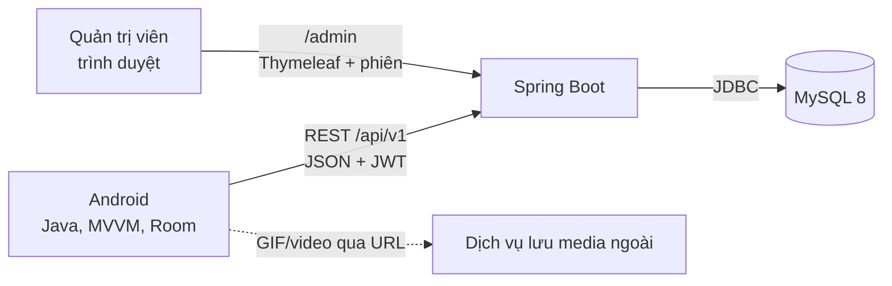

# HomeFit (IronFitness)

Ứng dụng **luyện tập tại nhà** gồm ứng dụng Android cho người dùng, máy chủ REST và trang quản trị web. Dự án học phần do nhóm sinh viên thực hiện.

- Người dùng chọn nhóm cơ (Bụng, Ngực, Chân, Toàn thân), xem bài tập có ảnh GIF minh họa, tập theo trình hướng dẫn có đếm ngược, xem lại lịch sử và thống kê.
- Quản trị viên cập nhật bài tập và theo dõi số liệu trên trang web mà không cần phát hành lại ứng dụng.
- Ứng dụng hoạt động **offline-first**: dữ liệu đã tải vẫn xem được khi mất mạng, buổi tập được ghi trên máy rồi đồng bộ lên máy chủ khi có mạng.

## Tính năng

**Ứng dụng Android**
- Đăng ký, đăng nhập bằng Email; nhập chiều cao, cân nặng và tự tính BMI kèm phân loại.
- Thư viện bài tập theo nhóm cơ: danh mục, danh sách bài, chi tiết bài (ảnh GIF, mô tả, thời gian hoặc số lần, thời gian nghỉ).
- Workout Player: đếm ngược từng bài và thời gian nghỉ, Tạm dừng/Tiếp tục/Bỏ qua, âm báo, bài theo thời gian hoặc theo số lần.
- Lịch sử buổi tập trên lịch, thống kê tổng số buổi và tổng số phút, nhắc tập hằng ngày bằng thông báo cục bộ.
- Quảng cáo Google AdMob (dùng ID thử nghiệm); người dùng Premium không thấy quảng cáo.

**Máy chủ và trang quản trị**
- API REST `/api/v1` xác thực bằng JWT, làm mới token có xoay vòng.
- Đồng bộ lịch sử buổi tập chống trùng bằng `clientUuid`.
- Trang `/admin` (đăng nhập bằng form): Dashboard, quản lý nhóm cơ, quản lý bài tập, bật/tắt Premium cho người dùng.

**Ngoài phạm vi hiện tại:** lịch tập tự xếp cho Premium, thanh toán, đăng nhập bằng số điện thoại. Đăng nhập Google đã có thiết kế nhưng chưa triển khai.

## Kiến trúc



Một máy chủ Spring Boot phục vụ cả ứng dụng (REST/JSON) và trang quản trị (Thymeleaf), dùng chung lớp service và repository. Media bài tập chỉ lưu **đường dẫn (URL)** trong cơ sở dữ liệu, máy chủ không lưu file.

Trong ứng dụng Android: Fragment → ViewModel → Repository → (Room hoặc Retrofit). Room là nguồn dữ liệu cho giao diện.

## Công nghệ

- **Android:** Java 17, XML + ViewBinding, MVVM, LiveData, Navigation Component, Room, Retrofit + Gson, OkHttp, Glide, Google AdMob. minSdk 26.
- **Backend:** Spring Boot 4.x, Java 17 trở lên, Spring Security + JWT (Nimbus), Spring Data JPA, Flyway, Thymeleaf, Bean Validation.
- **Cơ sở dữ liệu:** MySQL 8 (utf8mb4), schema do Flyway quản lý.
- **Công cụ:** Git/GitHub, Android Studio, Gradle, Maven wrapper, MySQL Workbench.

## Cấu trúc thư mục

```
IronFitness/
├── android/                    Ứng dụng Android (mở thư mục này bằng Android Studio)
│   └── app/src/main/java/com/homefit/app/
│       ├── ads/                AdMob (AdsManager)
│       ├── data/               local (Room), remote (Retrofit), repository, prefs
│       ├── domain/             Mappers
│       ├── ui/                 auth, profile, library, common
│       └── util/               Resource, BmiCalculator, DateUtils, ...
├── backend/                    Máy chủ Spring Boot
│   └── src/main/
│       ├── java/com/homefit/server/
│       │   ├── api/            Controller REST, DTO, xử lý lỗi thống nhất
│       │   ├── admin/          Controller trang quản trị (Thymeleaf)
│       │   ├── config/         Cấu hình bảo mật
│       │   ├── security/       Tạo JWT, đăng nhập admin
│       │   ├── domain/         Entity JPA
│       │   ├── repository/     Spring Data JPA
│       │   └── service/        Logic nghiệp vụ
│       └── resources/
│           ├── db/migration/   Flyway (V1, V2, ...)
│           └── templates/admin Trang quản trị
├── docs/                       Tài liệu (API, CSDL, quyết định, báo cáo, thiết kế, kiểm thử)
└── scripts/                    Script hỗ trợ (đo hiệu năng API)
```


## Tài liệu

- `docs/API.md`: hợp đồng REST giữa Android và backend.
- `docs/DATABASE.md`: schema MySQL và Room.
- `ARCHITECTURE.md`: kiến trúc Android và backend, trình tự Workout Player.
- `docs/ADS.md`: tích hợp AdMob, vị trí quảng cáo, kịch bản demo.
- `docs/DECISIONS.md`: các quyết định kiến trúc bổ sung.
- `docs/BACKEND.md`: chạy, cấu hình và xử lý lỗi thường gặp của backend.
- `docs/TASKS_WEEK*.md`: kế hoạch và tiến độ theo tuần.
- `docs/report/`: nội dung báo cáo.

