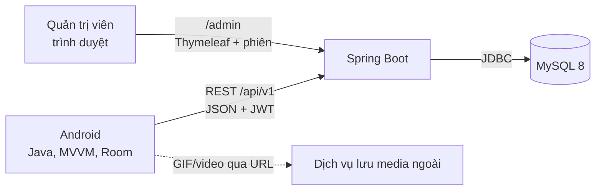

# HomeFit (IronFitness)

Ứng dụng **luyện tập tại nhà** gồm ứng dụng Android cho người dùng, máy chủ REST và trang quản trị web. Dự án học phần do nhóm sinh viên thực hiện.

- Người dùng chọn nhóm cơ (Bụng, Ngực, Chân, Toàn thân), xem bài tập có ảnh GIF minh họa, tập theo trình hướng dẫn có đếm ngược, xem lại lịch sử và thống kê.
- Quản trị viên cập nhật bài tập và theo dõi số liệu trên trang web mà không cần phát hành lại ứng dụng.
- Ứng dụng hoạt động **offline-first**: dữ liệu đã tải vẫn xem được khi mất mạng, buổi tập được ghi trên máy rồi đồng bộ lên máy chủ khi có mạng.

## Tính năng

**Ứng dụng Android**
- Đăng ký, đăng nhập bằng Email; nhập chiều cao, cân nặng và tự tính BMI kèm phân loại.
- Thư viện bài tập theo nhóm cơ: danh mục, danh sách bài, chi tiết bài (ảnh GIF, mô tả, thời gian hoặc số lần, thời gian nghỉ).
- Workout Player: đếm ngược từng bài và thời gian nghỉ, Tạm dừng/Tiếp tục/Bỏ qua, âm báo, bài theo thời gian hoặc theo số lần.
- Lịch sử buổi tập trên lịch, thống kê tổng số buổi và tổng số phút, nhắc tập hằng ngày bằng thông báo cục bộ.
- Quảng cáo Google AdMob (dùng ID thử nghiệm); người dùng Premium không thấy quảng cáo.

**Máy chủ và trang quản trị**
- API REST `/api/v1` xác thực bằng JWT, làm mới token có xoay vòng.
- Đồng bộ lịch sử buổi tập chống trùng bằng `clientUuid`.
- Trang `/admin` (đăng nhập bằng form): Dashboard, quản lý nhóm cơ, quản lý bài tập, bật/tắt Premium cho người dùng.

**Ngoài phạm vi hiện tại:** lịch tập tự xếp cho Premium, thanh toán, đăng nhập bằng số điện thoại. Đăng nhập Google đã có thiết kế nhưng chưa triển khai.

## Kiến trúc



Một máy chủ Spring Boot phục vụ cả ứng dụng (REST/JSON) và trang quản trị (Thymeleaf), dùng chung lớp service và repository. Media bài tập chỉ lưu **đường dẫn (URL)** trong cơ sở dữ liệu, máy chủ không lưu file.

Trong ứng dụng Android: Fragment → ViewModel → Repository → (Room hoặc Retrofit). Room là nguồn dữ liệu cho giao diện.

## Công nghệ

- **Android:** Java 17, XML + ViewBinding, MVVM, LiveData, Navigation Component, Room, Retrofit + Gson, OkHttp, Glide, Google AdMob. minSdk 26.
- **Backend:** Spring Boot 4.x, Java 17 trở lên, Spring Security + JWT (Nimbus), Spring Data JPA, Flyway, Thymeleaf, Bean Validation.
- **Cơ sở dữ liệu:** MySQL 8 (utf8mb4), schema do Flyway quản lý.
- **Công cụ:** Git/GitHub, Android Studio, Gradle, Maven wrapper, MySQL Workbench.

## Cấu trúc thư mục

```
IronFitness/
├── android/                    Ứng dụng Android (mở thư mục này bằng Android Studio)
│   └── app/src/main/java/com/homefit/app/
│       ├── ads/                AdMob (AdsManager)
│       ├── data/               local (Room), remote (Retrofit), repository, prefs
│       ├── domain/             Mappers
│       ├── ui/                 auth, profile, library, common
│       └── util/               Resource, BmiCalculator, DateUtils, ...
├── backend/                    Máy chủ Spring Boot
│   └── src/main/
│       ├── java/com/homefit/server/
│       │   ├── api/            Controller REST, DTO, xử lý lỗi thống nhất
│       │   ├── admin/          Controller trang quản trị (Thymeleaf)
│       │   ├── config/         Cấu hình bảo mật
│       │   ├── security/       Tạo JWT, đăng nhập admin
│       │   ├── domain/         Entity JPA
│       │   ├── repository/     Spring Data JPA
│       │   └── service/        Logic nghiệp vụ
│       └── resources/
│           ├── db/migration/   Flyway (V1, V2, ...)
│           └── templates/admin Trang quản trị
├── docs/                       Tài liệu (API, CSDL, quyết định, báo cáo, thiết kế, kiểm thử)
└── scripts/                    Script hỗ trợ (đo hiệu năng API)
```

## Bắt đầu nhanh

### Yêu cầu
- JDK 17 trở lên, MySQL 8, Android Studio (có Android SDK và một emulator có Google Play).
- Không cần cài Maven: dùng `mvnw.cmd` trong `backend/`.

### 1. Tạo cơ sở dữ liệu
```sql
CREATE DATABASE IF NOT EXISTS homefit CHARACTER SET utf8mb4 COLLATE utf8mb4_unicode_ci;
```

### 2. Cấu hình máy chủ
Sao chép `backend/src/main/resources/application-example.yml` thành `application-local.yml` (cùng thư mục) rồi điền giá trị thật. File này **không được commit**.

```yaml
spring:
  datasource:
    url: "jdbc:mysql://localhost:3306/homefit?useUnicode=true&characterEncoding=utf8&connectionTimeZone=UTC&useSSL=false&allowPublicKeyRetrieval=true"
    username: "root"
    password: "mat_khau_mysql"
homefit:
  jwt:
    secret: "chuoi-ngau-nhien-dai-it-nhat-32-ky-tu"
  admin:
    email: "admin@example.com"
    password: "mat_khau_admin_tu_8_ky_tu"
```

Lưu ý: đặt **mọi giá trị trong nháy kép** (ký tự `#` trong YAML bắt đầu một chú thích) và không đặt `ddl-auto`.

### 3. Chạy máy chủ
```powershell
cd backend
.\mvnw.cmd spring-boot:run "-Dspring-boot.run.profiles=local"
```
- Máy chủ chạy ở cổng **8090**. Lần đầu Flyway tạo bảng và dữ liệu mẫu.
- Trang quản trị: `http://localhost:8090/admin` (đăng nhập bằng tài khoản admin đã cấu hình ở trên).
- API: `http://localhost:8090/api/v1/...`

### 4. Chạy ứng dụng Android
1. Mở thư mục `android` bằng Android Studio, đợi Gradle đồng bộ.
2. Chạy trên emulator. Emulator gọi máy chủ qua `http://10.0.2.2:8090/api/v1/` (cấu hình ở `app/src/main/res/values/api_config.xml`).
3. Với điện thoại thật: đổi địa chỉ trong `api_config.xml` thành `http://<IP-LAN-của-máy-chạy-backend>:8090/api/v1/`, điện thoại cùng Wi-Fi và cổng 8090 được phép qua tường lửa.

HTTP thường chỉ được bật ở bản debug.

## API tóm tắt

Chi tiết trong `docs/API.md`. Mọi lỗi trả JSON `{ "code", "message" }`.

- Xác thực (công khai): `POST /api/v1/auth/register`, `POST /api/v1/auth/login`, `POST /api/v1/auth/refresh`
- Hồ sơ: `GET /api/v1/me`, `PUT /api/v1/me/profile`
- Thư viện: `GET /api/v1/categories`, `GET /api/v1/exercises` (tham số `updatedAfter` để đồng bộ phần mới đổi, `categoryId` để lọc)
- Lịch sử: `POST /api/v1/workout-sessions`, `POST /api/v1/workout-sessions/batch`, `GET /api/v1/workout-sessions`

## Kiểm thử

```powershell
# Backend: kiểm thử đơn vị và tích hợp (cần MySQL đang chạy và application-local.yml)
cd backend
.\mvnw.cmd verify "-Dspring.profiles.active=local"

# Android: kiểm thử đơn vị
cd android
.\gradlew.bat testDebugUnitTest
```

Kiểm thử tích hợp khởi động máy chủ thật và gọi API bằng HTTP; dữ liệu thử dùng email bắt đầu bằng `it-` và tự xóa sau mỗi test. Script đo thời gian phản hồi API: `scripts/perf-api.ps1`.

## Tài liệu

- `docs/API.md`: hợp đồng REST giữa Android và backend.
- `docs/DATABASE.md`: schema MySQL và Room.
- `ARCHITECTURE.md`: kiến trúc Android và backend, trình tự Workout Player.
- `docs/ADS.md`: tích hợp AdMob, vị trí quảng cáo, kịch bản demo.
- `docs/DECISIONS.md`: các quyết định kiến trúc bổ sung.
- `docs/BACKEND.md`: chạy, cấu hình và xử lý lỗi thường gặp của backend.
- `docs/TASKS_WEEK*.md`: kế hoạch và tiến độ theo tuần.
- `docs/report/`: nội dung báo cáo.

## Khắc phục sự cố nhanh

- **`using password: NO` hoặc `Access denied`:** mật khẩu trong YAML chưa nằm trong nháy kép hoặc sai.
- **`no profiles are currently active`:** chạy máy chủ bằng `"-Dspring-boot.run.profiles=local"`; còn lệnh `verify` dùng `"-Dspring.profiles.active=local"`.
- **`wrong column type ... decimal`:** đang đặt `ddl-auto: validate`; xóa dòng đó.
- **Ứng dụng báo "không kết nối được máy chủ":** kiểm tra máy chủ đang chạy, cổng trong `api_config.xml`, và (với điện thoại thật) dùng IP LAN.

## Làm việc nhóm

- Nhánh `main` luôn build được. Mỗi người làm trên nhánh riêng `tên thành viên`, mở Pull Request vào `main`, trưởng nhóm kỹ thuật duyệt rồi Squash and merge.
- Thông điệp commit: `<loại>(<phạm vi>): <mô tả> [<task-id>]`, ví dụ `feat(auth): API dang ky [W1-TV4-03]`.
- Không commit bí mật: `application-local.yml`, `local.properties`, keystore, mật khẩu, khóa JWT.
- Schema MySQL chỉ đổi bằng file Flyway mới `V{n}__mo_ta.sql`; không sửa migration đã chạy.


## Giấy phép và nội dung

Dự án phục vụ học tập, chưa chọn giấy phép mã nguồn mở. Ảnh GIF và video minh họa bài tập phải có quyền sử dụng hợp lệ; dữ liệu bài tập mẫu hiện có chỉ dùng để thử giao diện.
