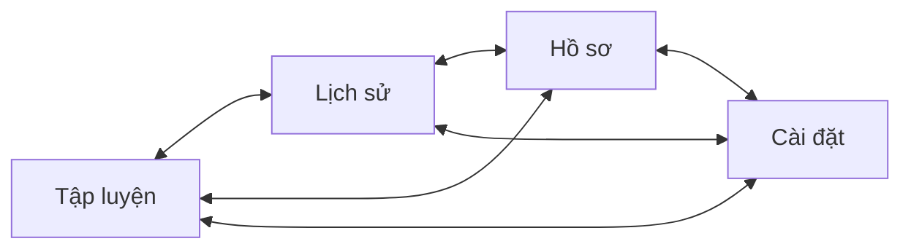

# Đóng góp báo cáo – Nguyên tắc thiết kế giao diện và khung điều hướng

- Đợt: 1
- Ngày: 2026-10-30
- Tác giả: Agent 6 (Frontend)
- Task liên quan: W2-TV6-01, W2-TV6-02
- Phần báo cáo: Chương 1 (điểm tối ưu), Chương 4 (nguyên tắc thiết kế và sơ đồ điều hướng)
- Trạng thái màn hình: chỉ bố cục (khung 4 tab và màn mẫu tạm; chưa có màn nghiệp vụ trong file này)
- Môi trường chụp: [CHỜ: tên emulator, độ phân giải, phiên bản Android do người điều phối ghi khi chụp]

## 1. Tổng quan

Ứng dụng dùng **Material 3** với tông **cam sắt** trên nền trung tính ấm, hỗ trợ **chế độ sáng và tối** và giao diện **tiếng Việt**. Mọi màu, khoảng cách, cỡ chữ được gom thành bộ token dùng chung, nên các màn hình có giao diện nhất quán và đổi chế độ sáng/tối không cần viết lại từng màn. Khung chính là một Activity chứa thanh điều hướng dưới với 4 tab: Tập luyện, Lịch sử, Hồ sơ, Cài đặt.

## 2. Danh sách màn hình

### 2.1 Khung điều hướng chính (thanh 4 tab)
- **Mục đích:** cho người dùng chuyển nhanh giữa 4 nhóm chức năng chính.
- **Thành phần chính:** thanh điều hướng dưới có biểu tượng và nhãn chữ: Tập luyện, Lịch sử, Hồ sơ, Cài đặt.
- **Thao tác và kết quả:**
  1. Bấm một tab → màn hình của tab đó hiện ra, tab được tô nổi bật.
  2. Chuyển qua lại giữa các tab → mỗi tab giữ trạng thái riêng.
  3. Bấm vào ô nhập chữ → bàn phím hiện, thanh điều hướng dưới tự ẩn để nhường chỗ; đóng bàn phím thì thanh hiện lại.
- **Các trạng thái đã xử lý:** chế độ sáng và tối, xoay ngang/dọc, điều hướng bằng 3 nút và bằng cử chỉ (nội dung không bị thanh hệ thống đè).
- **Dữ liệu từ đâu:** không dùng dữ liệu; chỉ là khung điều hướng.
- **Ảnh chụp:**

| Tệp | Mô tả (chú thích hình) |
|---|---|
| `images/ui/ui-themegallery-default-light.png` | [CHỜ: ảnh chưa chụp] Màn mẫu thành phần dùng chung ở chế độ sáng: thẻ, 4 kiểu nút, ô nhập, 3 màu trạng thái Player |
| `images/ui/ui-themegallery-default-dark.png` | [CHỜ: ảnh chưa chụp] Cùng màn ở chế độ tối |

Lưu ý khi dùng ảnh: đây là **màn mẫu tạm** dùng để kiểm tra theme, sẽ bị thay bằng màn thật ở các task sau. Nếu đưa vào báo cáo, chú thích là "màn mẫu thành phần giao diện".

## 3. Sơ đồ điều hướng (khung chính)

Bốn tab là các điểm đến ngang hàng, người dùng chuyển qua lại tự do bằng thanh điều hướng dưới. Luồng đăng nhập đi trước khung này và được mô tả ở file `agent6-dot2-man-tai-khoan.md`.

## 4. Nguyên tắc thiết kế áp dụng

**Nền tảng:** Material 3, theme `Theme.Material3.DayNight.NoActionBar`, một Activity và nhiều Fragment. Phông chữ là phông hệ thống, không thêm phông ngoài.

**Bảng màu (vai trò chính):**

| Vai trò | Sáng | Tối | Dùng cho |
|---|---|---|---|
| primary | `#B83F00` | `#FFB596` | Nút chính, tab đang chọn, nhấn mạnh |
| secondary | `#4E5F6B` | `#B6C9D8` | Hành động phụ |
| tertiary | `#00696B` | `#4CD9DB` | Trạng thái nghỉ, hồi phục |
| error | `#BA1A1A` | `#FFB4AB` | Lỗi |
| background / surface | `#FFFBF8` | `#181210` | Nền màn hình |
| surfaceContainer | `#F8EDE6` | `#241C19` | Thẻ nội dung |
| onSurfaceVariant | `#52443C` | `#D8C2B8` | Chữ phụ, mô tả |

**Màu theo trạng thái (luôn đi kèm chữ, không dùng màu đơn lẻ):**

| Trạng thái | Sáng | Tối |
|---|---|---|
| Đang tập | `#B83F00` | `#FFB596` |
| Đang nghỉ | `#00696B` | `#4CD9DB` |
| Tạm dừng | `#4E5F6B` | `#B6C9D8` |
| BMI gầy | `#1D5FA8` | `#A5C8FF` |
| BMI bình thường | `#1B6D2F` | `#7DDB8B` |
| BMI thừa cân | `#8A5100` | `#FFB95C` |
| BMI béo phì | `#BA1A1A` | `#FFB4AB` |

**Kiểu chữ:**

| Kiểu | Cỡ | Dùng cho |
|---|---|---|
| Timer | 72sp, số cùng độ rộng | Đếm ngược trong Workout Player |
| Headline | 28sp, đậm | Tiêu đề màn hình |
| Title | 20sp, đậm | Tiêu đề thẻ |
| Body | 16sp | Nội dung |
| BodySmall | 14sp | Mô tả phụ |
| Caption | 12sp | Nhãn nhỏ |

**Hình dạng và khoảng cách:** bo góc 12dp (nút, ô nhập), 16dp (thẻ), 28dp (khung lớn); khoảng cách theo thang 4, 8, 12, 16, 24, 32dp; nút cao 52dp (nút trong Player cao 64dp); vùng chạm tối thiểu 48dp.

**Thành phần dùng chung:** nút chính, nút phụ (tonal), nút viền, nút chữ, ô nhập kiểu outlined, thẻ nội dung, thanh điều hướng dưới. Mỗi thành phần có một kiểu khai báo một lần, các màn chỉ gọi lại.

**Lý do chọn:**
- Màu cam là màu hành động, tạo cảm giác năng động phù hợp ứng dụng tập luyện; màu xanh ngọc dành riêng cho trạng thái nghỉ nên người tập phân biệt được "tập" và "nghỉ" bằng màu, đồng thời vẫn có chữ đi kèm.
- Bộ màu sáng và tối dùng chung tên, theme chỉ khai báo một lần, nên thêm màn mới tự hỗ trợ cả hai chế độ.
- Cỡ chữ dùng đơn vị `sp` để theo cỡ chữ người dùng đặt trong hệ thống.

## 5. Điểm tối ưu về trải nghiệm có thể đưa vào báo cáo

| Điểm | Cách kiểm chứng (ảnh hoặc thao tác) |
|---|---|
| Hỗ trợ **chế độ tối** đầy đủ, màu chữ đủ tương phản | Ảnh `ui-themegallery-default-dark.png` [CHỜ: ảnh]; thao tác: bật chế độ tối của hệ thống, mở app |
| **Độ tương phản đạt WCAG**: mọi cặp chữ và nền đạt tối thiểu 4,5:1 (tính bằng script từ chính file `colors.xml`); viền ô nhập đạt 4,38:1 ở chế độ sáng và 5,86:1 ở chế độ tối (yêu cầu 3:1) | Bảng tỉ lệ ở `docs/design/tokens.md` mục 3 |
| **Không dựa vào màu đơn lẻ**: trạng thái BMI và trạng thái Player luôn có nhãn chữ đi kèm | Xem ảnh màn Hồ sơ (file `agent6-dot2-man-tai-khoan.md`) và Player [CHỜ: đợt sau] |
| **Tràn viền** (edge-to-edge) và xử lý bàn phím: nội dung không bị thanh trạng thái, thanh điều hướng hệ thống hoặc bàn phím che | Thao tác: bấm vào ô nhập, bàn phím hiện và thanh 4 tab tự ẩn [CHỜ: ảnh] |
| **Giao diện tiếng Việt** toàn bộ; chuỗi nằm trong tệp tài nguyên, dễ chỉnh sửa | Mở các màn hình trong app |
| **Vùng chạm tối thiểu 48dp** cho nút và ô nhập | Mô tả trong `docs/design/tokens.md` mục 1 |

Chưa kiểm tra bằng trình đọc màn hình TalkBack; chưa nên đưa vào báo cáo như một điểm đã kiểm chứng.

## 6. Khó khăn và cách giải quyết

- **Theme mất màu ở chế độ tối.** Tệp mẫu `values-night/themes.xml` do công cụ tạo project sinh ra khai báo lại toàn bộ theme, nên ghi đè và làm mất cấu hình màu khi bật chế độ tối. → Chuyển toàn bộ cấu hình theme vào một tệp duy nhất, màu đổi theo cặp tệp màu sáng/tối cùng tên, và để tệp theme của chế độ tối trống.
- **Tràn viền làm nội dung bị thanh hệ thống và bàn phím che.** → Để `MainActivity` xử lý các khoảng đệm một lần cho cả ứng dụng, các màn hình không phải tự cộng khoảng cách; thanh điều hướng dưới tự ẩn khi bàn phím mở.
- **Điểm vào của ứng dụng là màn Splash nhưng thanh 4 tab cần chuyển tab theo một tab gốc.** → Tự viết xử lý chuyển tab lấy tab Tập luyện làm gốc, thay vì dùng mặc định (xem `agent6-dot2-man-tai-khoan.md`).

## 7. Hạn chế hiện tại và đề xuất cải tiến

- Chưa có logo thương hiệu riêng; màn khởi động đang dùng biểu tượng và tên ứng dụng. Đề xuất: thiết kế logo và biểu tượng ứng dụng riêng.
- Chưa kiểm tra TalkBack và chưa tối ưu bố cục cho máy tính bảng. Đề xuất: bổ sung ở giai đoạn sau nếu còn thời gian.
- Phông chữ dùng phông hệ thống để giữ ứng dụng nhẹ; có thể dùng phông riêng nếu cần nhận diện thương hiệu mạnh hơn.

## 8. Nguồn

- Task: W2-TV6-01, W2-TV6-02
- File mã liên quan: `android/app/src/main/res/values/colors.xml`, `values-night/colors.xml`, `values/styles.xml`, `values/themes.xml`, `values/dimens.xml`, `res/navigation/nav_graph.xml`, `res/layout/activity_main.xml`, `MainActivity.java`
- Tài liệu thiết kế: `docs/design/tokens.md`
