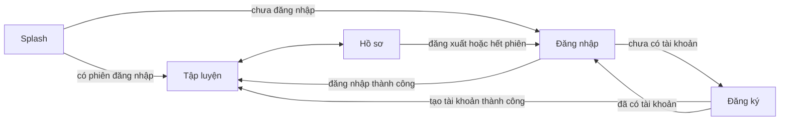

# Đóng góp báo cáo – Màn hình tài khoản (Splash, Đăng nhập, Đăng ký, Hồ sơ và BMI)

- Đợt: 2
- Ngày: 2026-10-30
- Tác giả: Agent 6 (Frontend)
- Task liên quan: W2-TV6-03 (gồm phần giao diện của W2-TV2-01, 02, 07)
- Phần báo cáo: Chương 4, bảng chức năng mục D02 (đăng ký, đăng nhập) và D03 (hồ sơ và BMI)
- Trạng thái màn hình: **đã nối dữ liệu thật** (qua `AuthRepository`, API `/auth/*` và `/me`); **mô tả dưới đây viết theo mã nguồn, chưa chạy kiểm chứng đầu-cuối và chưa có ảnh chụp**. Người làm báo cáo chỉ nên dùng phần này sau khi các mục `[CHỜ]` được thay bằng ảnh thật
- Môi trường chụp: [CHỜ: tên emulator, độ phân giải, phiên bản Android]
- Ghi chú: đăng nhập bằng **Google chưa làm** (xem mục 7)

## 1. Tổng quan

Nhóm màn hình này cho phép người dùng tạo tài khoản bằng Email, đăng nhập, rồi cập nhật chiều cao và cân nặng để xem chỉ số BMI cùng mức phân loại. Ứng dụng nhớ phiên đăng nhập nên lần mở sau vào thẳng màn chính; người dùng có thể đăng xuất ở màn Hồ sơ.

## 2. Danh sách màn hình

### 2.1 Splash (khởi động)
- **Mục đích:** hiển thị thương hiệu trong lúc ứng dụng quyết định mở màn Đăng nhập hay vào thẳng màn chính.
- **Thành phần chính:** biểu tượng, tên ứng dụng, câu giới thiệu "Tập luyện tại nhà, mọi lúc mọi nơi", vòng tải.
- **Thao tác và kết quả:**
  1. Mở ứng dụng → màn Splash hiện khoảng 0,8 giây.
  2. Nếu đã có phiên đăng nhập → vào tab Tập luyện; nếu chưa → vào màn Đăng nhập.
- **Các trạng thái đã xử lý:** chế độ sáng và tối.
- **Dữ liệu từ đâu:** kiểm tra token đăng nhập đã lưu trên máy.
- **Ảnh chụp:**

| Tệp | Mô tả (chú thích hình) |
|---|---|
| `images/ui/ui-splash-default-light.png` | [CHỜ: ảnh chưa chụp] Màn khởi động, chế độ sáng |
| `images/ui/ui-splash-default-dark.png` | [CHỜ: ảnh chưa chụp] Chế độ tối |

### 2.2 Đăng nhập
- **Mục đích:** cho người dùng đã có tài khoản vào ứng dụng bằng Email và mật khẩu.
- **Thành phần chính:** ô Email, ô Mật khẩu (có nút hiện/ẩn mật khẩu), nút "Đăng nhập", nút "Chưa có tài khoản? Đăng ký".
- **Thao tác và kết quả:**
  1. Để trống hoặc nhập email sai định dạng rồi bấm "Đăng nhập" → thông báo lỗi hiện ngay dưới ô nhập ("Vui lòng nhập email.", "Email không hợp lệ.", "Vui lòng nhập mật khẩu.").
  2. Nhập đúng email và mật khẩu, bấm "Đăng nhập" → nút đổi thành "Đang đăng nhập…" và bị khóa, các ô nhập bị khóa, hiện thanh tiến trình.
  3. Đăng nhập thành công → vào tab Tập luyện; bấm Back không quay lại màn Đăng nhập.
  4. Sai email hoặc mật khẩu → dòng lỗi màu đỏ "Email hoặc mật khẩu không đúng."
  5. Mất kết nối hoặc không tới được máy chủ → hiện thông báo lỗi bằng tiếng Việt [CHỜ: chép nguyên văn thông báo khi chụp ảnh].
  6. Bấm "Chưa có tài khoản? Đăng ký" → sang màn Đăng ký.
- **Các trạng thái đã xử lý:** đang tải, lỗi nhập liệu, lỗi từ máy chủ, lỗi mạng, giữ nguyên trạng thái khi xoay màn hình, chế độ tối.
- **Dữ liệu từ đâu:** `AuthRepository.login` qua API `POST /auth/login`. Sau khi đăng nhập thành công, ứng dụng đẩy các buổi tập chưa đồng bộ lên máy chủ và khôi phục lịch sử tập từ máy chủ.
- **Ảnh chụp:**

| Tệp | Mô tả (chú thích hình) |
|---|---|
| `images/ui/ui-login-default-light.png` | [CHỜ: ảnh chưa chụp] Màn Đăng nhập, trạng thái mặc định, chế độ sáng |
| `images/ui/ui-login-validation-light.png` | [CHỜ: ảnh chưa chụp] Thông báo lỗi dưới ô nhập khi để trống hoặc email sai |
| `images/ui/ui-login-error-light.png` | [CHỜ: ảnh chưa chụp] Dòng lỗi "Email hoặc mật khẩu không đúng." |
| `images/ui/ui-login-default-dark.png` | [CHỜ: ảnh chưa chụp] Chế độ tối |

### 2.3 Đăng ký
- **Mục đích:** tạo tài khoản mới bằng Email.
- **Thành phần chính:** ô Họ tên, Email, Mật khẩu, Nhập lại mật khẩu (hai ô mật khẩu có nút hiện/ẩn), nút "Tạo tài khoản", nút "Đã có tài khoản? Đăng nhập".
- **Thao tác và kết quả:**
  1. Bấm "Tạo tài khoản" khi dữ liệu chưa hợp lệ → lỗi hiện dưới từng ô: họ tên 1 đến 100 ký tự, email đúng định dạng, mật khẩu tối thiểu 8 ký tự ("Mật khẩu tối thiểu 8 ký tự."), nhập lại mật khẩu phải khớp ("Mật khẩu nhập lại không khớp.").
  2. Nhập hợp lệ rồi bấm → nút đổi thành "Đang tạo tài khoản…", hiện thanh tiến trình.
  3. Thành công → vào thẳng tab Tập luyện (không cần đăng nhập lại).
  4. Email đã được đăng ký → hiện thông báo do máy chủ trả về [CHỜ: chép nguyên văn khi chụp ảnh].
  5. Bấm "Đã có tài khoản? Đăng nhập" → quay lại màn Đăng nhập.
- **Các trạng thái đã xử lý:** đang tải, lỗi nhập liệu, lỗi từ máy chủ, lỗi mạng, chế độ tối.
- **Dữ liệu từ đâu:** `AuthRepository.register` qua API `POST /auth/register`.
- **Ảnh chụp:**

| Tệp | Mô tả (chú thích hình) |
|---|---|
| `images/ui/ui-register-default-light.png` | [CHỜ: ảnh chưa chụp] Màn Đăng ký, trạng thái mặc định |
| `images/ui/ui-register-validation-light.png` | [CHỜ: ảnh chưa chụp] Lỗi nhập liệu: mật khẩu ngắn, nhập lại không khớp |
| `images/ui/ui-register-default-dark.png` | [CHỜ: ảnh chưa chụp] Chế độ tối |

### 2.4 Hồ sơ và BMI
- **Mục đích:** xem thông tin tài khoản, cập nhật họ tên, chiều cao, cân nặng và xem chỉ số BMI cùng mức phân loại; đăng xuất.
- **Thành phần chính:** thẻ thông tin tài khoản (họ tên, email, dòng "Tài khoản Premium: không hiển thị quảng cáo" nếu có), ô Họ tên, ô Chiều cao (cm), ô Cân nặng (kg), thẻ BMI, nút "Lưu hồ sơ", nút "Đăng xuất".
- **Thao tác và kết quả:**
  1. Mở tab Hồ sơ → các ô được điền sẵn từ hồ sơ đã lưu trên máy.
  2. Nhập chiều cao và cân nặng hợp lệ → thẻ BMI cập nhật ngay trong lúc gõ: hiện giá trị (một chữ số thập phân) và nhãn phân loại bằng chữ có màu: Gầy (dưới 18,5), Bình thường (18,5 đến 24,9), Thừa cân (25 đến 29,9), Béo phì (từ 30). Khi chưa đủ số liệu hợp lệ, thẻ hiện "Nhập chiều cao và cân nặng hợp lệ để xem BMI."
  3. Nhập chiều cao ngoài khoảng 50 đến 250 cm hoặc cân nặng ngoài khoảng 20 đến 300 kg, bấm "Lưu hồ sơ" → lỗi dưới ô tương ứng ("Chiều cao phải từ 50 đến 250 cm.", "Cân nặng phải từ 20 đến 300 kg.").
  4. Bấm "Lưu hồ sơ" khi hợp lệ → thông báo "Đã lưu hồ sơ."
  5. Lưu khi mất mạng → dữ liệu vẫn được lưu trên máy và thông báo cho biết chưa đồng bộ được lên máy chủ ("Đã lưu trên máy nhưng chưa đồng bộ được: …").
  6. Bấm "Đăng xuất" → hộp thoại xác nhận "Lịch sử tập của bạn vẫn được giữ trên máy này."; đồng ý thì về màn Đăng nhập.
  7. Khi phiên đăng nhập hết hạn lúc mở ứng dụng hoặc lúc chuyển tab → ứng dụng tự đưa về màn Đăng nhập kèm thông báo "Phiên đăng nhập đã hết hạn. Vui lòng đăng nhập lại."; nếu hết hạn đúng lúc đang lưu hồ sơ thì chỉ đưa về màn Đăng nhập, không có thông báo.
- **Các trạng thái đã xử lý:** đang lưu, lỗi nhập liệu, lỗi lưu, lưu cục bộ khi mất mạng, hết phiên, giữ chữ đang gõ khi xoay màn hình, chế độ tối. Chiều cao và cân nặng là tùy chọn; để trống thì chỉ không có BMI. Chấp nhận cả dấu phẩy và dấu chấm khi nhập số thập phân.
- **Dữ liệu từ đâu:** hồ sơ lưu trên máy (Room); lưu lên máy chủ qua `AuthRepository.updateProfile` (API `PUT /me/profile`); làm mới hồ sơ khi mở ứng dụng qua `GET /me`.
- **Ảnh chụp:**

| Tệp | Mô tả (chú thích hình) |
|---|---|
| `images/ui/ui-profile-default-light.png` | [CHỜ: ảnh chưa chụp] Màn Hồ sơ, trạng thái mặc định |
| `images/ui/ui-profile-bmi-underweight-light.png` | [CHỜ: ảnh chưa chụp] BMI mức Gầy |
| `images/ui/ui-profile-bmi-normal-light.png` | [CHỜ: ảnh chưa chụp] BMI mức Bình thường |
| `images/ui/ui-profile-bmi-overweight-light.png` | [CHỜ: ảnh chưa chụp] BMI mức Thừa cân |
| `images/ui/ui-profile-bmi-obese-light.png` | [CHỜ: ảnh chưa chụp] BMI mức Béo phì |
| `images/ui/ui-profile-validation-light.png` | [CHỜ: ảnh chưa chụp] Lỗi khi nhập chiều cao hoặc cân nặng ngoài khoảng cho phép |
| `images/ui/ui-profile-bmi-normal-dark.png` | [CHỜ: ảnh chưa chụp] Chế độ tối |

Giá trị BMI trong ảnh phải khớp công thức BMI = cân nặng (kg) chia cho bình phương chiều cao (m); khi chụp ghi rõ chiều cao và cân nặng đã nhập ở chú thích.

## 3. Sơ đồ điều hướng

Ứng dụng luôn mở bằng Splash. Sau khi đăng nhập hoặc đăng ký thành công, ngăn xếp điều hướng được xóa sạch nên nút Back không đưa người dùng quay lại các màn đăng nhập. Ở bước này tab Tập luyện vẫn là màn mẫu tạm; màn Danh mục thật được thêm ở task sau.

## 4. Nguyên tắc thiết kế áp dụng (nếu có thay đổi so với đợt trước)

Không đổi bộ token đã mô tả ở `agent6-dot1-nguyen-tac-thiet-ke.md`. Điểm mới ở nhóm màn này:
- Lỗi nhập liệu hiện **ngay dưới từng ô** và tự mất khi người dùng gõ lại; lỗi từ máy chủ hiện thành một dòng màu lỗi phía trên nút.
- Khi đang gọi máy chủ, nút bấm bị khóa và đổi nhãn để tránh gửi trùng, kèm thanh tiến trình.
- Mức BMI được thể hiện bằng **cả chữ và màu**, màu chữ lấy từ bộ màu BMI đã kiểm tra tương phản.

## 5. Điểm tối ưu về trải nghiệm có thể đưa vào báo cáo

| Điểm | Cách kiểm chứng (ảnh hoặc thao tác) |
|---|---|
| Thông báo lỗi **rõ ràng bằng tiếng Việt**, đặt đúng chỗ (dưới từng ô nhập) | Ảnh `ui-login-validation-light.png`, `ui-register-validation-light.png` [CHỜ: ảnh] |
| **BMI cập nhật ngay khi gõ**, có nhãn chữ kèm màu | Thao tác: nhập chiều cao, cân nặng và quan sát thẻ BMI; ảnh `ui-profile-bmi-*` [CHỜ: ảnh] |
| **Không mất dữ liệu khi mất mạng**: hồ sơ lưu trên máy trước rồi mới đồng bộ | Thao tác: tắt mạng, lưu hồ sơ, đọc thông báo [CHỜ: ảnh và xác nhận khi chạy thật] |
| **Phiên đăng nhập được nhớ**, mở lại ứng dụng vào thẳng màn chính | Thao tác: đăng nhập, đóng hẳn ứng dụng, mở lại [CHỜ: xác nhận khi chạy thật] |
| Xoay màn hình không mất chữ đang gõ và không gửi trùng yêu cầu | Thao tác: xoay ngang khi đang nhập hoặc đang chờ phản hồi [CHỜ: xác nhận khi chạy thật] |

## 6. Khó khăn và cách giải quyết

- **Thanh điều hướng dưới và màn Splash.** Cách chuyển tab mặc định của thư viện Navigation tính theo màn đầu tiên của đồ thị; ở đây màn đầu tiên là Splash (không phải tab), nên chuyển tab sẽ làm ngăn xếp dài ra và Back đi qua nhiều tab. → Tự viết xử lý chuyển tab lấy tab Tập luyện làm gốc, giữ trạng thái từng tab.
- **Hết phiên đăng nhập có thể xảy ra ở bất kỳ màn nào.** → Đặt kiểm tra tập trung ở khung chính: nếu không còn token khi vào một tab, hoặc máy chủ báo hết phiên khi làm mới hồ sơ lúc mở ứng dụng, thì đưa về Đăng nhập kèm thông báo.
- **Xoay màn hình khi đang gọi máy chủ** dễ làm gửi trùng hoặc mất kết quả. → Giữ trạng thái gọi API trong ViewModel; các thông báo chỉ hiện một lần.

## 7. Hạn chế hiện tại và đề xuất cải tiến

- **Đăng nhập bằng Google chưa làm.** [CHỜ] Cần: thư viện đăng nhập Google (chưa nằm trong danh sách được duyệt), mã định danh ứng dụng (OAuth client ID) cấu hình ngoài Git, và API `POST /auth/google` ở máy chủ. Báo cáo không nên mô tả tính năng này là đã hoàn thành.
- Chưa có chức năng quên mật khẩu hoặc đổi mật khẩu (ngoài phạm vi MVP).
- Chưa có xác thực email.
- Tab Tập luyện sau khi đăng nhập hiện là màn mẫu tạm cho đến khi màn Danh mục thật hoàn thành.

## 8. Nguồn

- Task: W2-TV6-03
- File mã liên quan: `ui/auth/SplashFragment.java`, `LoginFragment.java`, `RegisterFragment.java`, `AuthValidator.java`, `ui/profile/ProfileFragment.java`, `ProfileViewModel.java`, `MainActivity.java`, `MainViewModel.java`; layout `fragment_splash.xml`, `fragment_login.xml`, `fragment_register.xml`, `fragment_profile.xml`; `res/navigation/nav_graph.xml`
- Tài liệu thiết kế: `docs/design/tokens.md`; hợp đồng API: `docs/API.md` mục 1, 2
