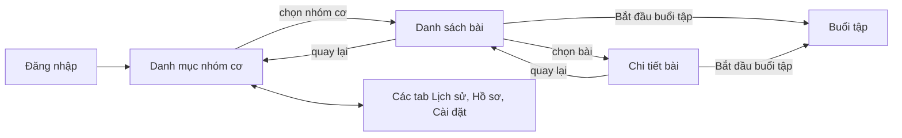

# Đóng góp báo cáo – Thư viện bài tập (Danh mục, Danh sách bài, Chi tiết bài)

- Đợt: 2
- Ngày: 2026-11-01
- Tác giả: Agent 6 (Frontend)
- Task liên quan: W2-TV6-04, W2-TV6-07 (gồm phần giao diện của W2-TV3-01, W2-TV3-02, W2-TV3-06)
- Phần báo cáo: Chương 4, bảng chức năng mục D04; một phần D01 (banner AdMob trên màn thật)
- Trạng thái màn hình: **đã nối dữ liệu thật** (đọc từ Room, đồng bộ qua `ExerciseRepository`, API `GET /categories` và `GET /exercises`); **mô tả theo mã nguồn, chưa chạy kiểm chứng đầu-cuối và chưa có ảnh chụp**. Nút "Bắt đầu buổi tập" hiện mở một **màn tạm** vì Workout Player chưa hoàn thành
- Môi trường chụp: [CHỜ: tên emulator, độ phân giải, phiên bản Android]
- Điều kiện để có dữ liệu thật trong ảnh: [CHỜ: cần máy chủ có API đọc danh mục, bài tập và dữ liệu mẫu 12 đến 16 bài kèm link GIF còn sống]

## 1. Tổng quan

Người dùng mở tab Tập luyện, chọn một nhóm cơ (Bụng, Ngực, Chân, Toàn thân), xem danh sách bài tập của nhóm đó rồi mở chi tiết từng bài để xem GIF minh họa, thời gian hoặc số lần tập, thời gian nghỉ và hướng dẫn. Dữ liệu được lưu trên máy (Room) nên vẫn xem được khi mất mạng; khi có mạng, ứng dụng tự cập nhật từ máy chủ.

## 2. Danh sách màn hình

### 2.1 Danh mục nhóm cơ (tab Tập luyện)
- **Mục đích:** cho người dùng chọn nhóm cơ muốn tập.
- **Thành phần chính:** tiêu đề "Tập luyện", câu "Chọn nhóm cơ để bắt đầu", lưới thẻ nhóm cơ (biểu tượng và tên), banner quảng cáo ở cuối màn.
- **Thao tác và kết quả:**
  1. Mở tab Tập luyện → hiện vòng tải, sau đó lưới nhóm cơ (2 cột khi cầm dọc, 4 cột khi xoay ngang).
  2. Bấm một thẻ → mở danh sách bài của nhóm đó.
  3. Chưa có dữ liệu và máy chủ trả về rỗng → hiện "Chưa có nhóm cơ nào. Hãy kết nối mạng để tải dữ liệu bài tập." kèm nút "Thử lại".
  4. Chưa có dữ liệu và tải lỗi → hiện thông báo lỗi bằng tiếng Việt kèm nút "Thử lại".
  5. Đã có dữ liệu trên máy mà tải mới lỗi (ví dụ mất mạng) → vẫn hiển thị dữ liệu đã lưu.
  6. Đang ở màn sâu hơn (danh sách, chi tiết), bấm lại tab Tập luyện → quay về màn Danh mục.
- **Biểu tượng nhóm cơ:** dùng ảnh từ máy chủ nếu có `iconUrl`, nếu không dùng biểu tượng có sẵn trong ứng dụng theo mã nhóm (abs, chest, legs, full_body).
- **Các trạng thái đã xử lý:** đang tải, rỗng, lỗi (có nút thử lại), có dữ liệu cũ khi offline, xoay màn hình, chế độ tối.
- **Quảng cáo:** banner AdMob thử nghiệm (nhãn "Test Ad") ở cuối màn khi tài khoản không phải Premium; tài khoản Premium không thấy banner.
- **Dữ liệu từ đâu:** Room (bảng nhóm cơ) làm nguồn hiển thị; `ExerciseRepository.refresh()` đồng bộ từ máy chủ mỗi khi mở màn.
- **Ảnh chụp:**

| Tệp | Mô tả (chú thích hình) |
|---|---|
| `images/ui/ui-category-default-light.png` | [CHỜ: ảnh chưa chụp] Danh mục 4 nhóm cơ, chế độ sáng, thấy banner Test Ad ở cuối |
| `images/ui/ui-category-default-dark.png` | [CHỜ: ảnh chưa chụp] Chế độ tối |
| `images/ui/ui-category-empty-light.png` | [CHỜ: ảnh chưa chụp] Trạng thái rỗng có nút Thử lại |
| `images/ui/ui-category-error-light.png` | [CHỜ: ảnh chưa chụp] Trạng thái lỗi mạng có nút Thử lại |

### 2.2 Danh sách bài tập
- **Mục đích:** xem các bài của một nhóm cơ và bắt đầu buổi tập cho nhóm đó.
- **Thành phần chính:** nút quay lại, tên nhóm cơ, danh sách bài (ảnh nhỏ, tên bài, "30 giây · Nghỉ 15 giây" hoặc "12 lần · Nghỉ 15 giây"), nút "Bắt đầu buổi tập", banner quảng cáo.
- **Thao tác và kết quả:**
  1. Vào từ Danh mục → danh sách bài của nhóm cơ đã chọn.
  2. Bấm một bài → mở màn Chi tiết bài.
  3. Bấm "Bắt đầu buổi tập" → mở màn buổi tập của nhóm cơ này. **Hiện là màn tạm**, chưa phải Workout Player [CHỜ: cập nhật khi Player hoàn thành].
  4. Nhóm cơ chưa có bài → "Nhóm cơ này chưa có bài tập." (nút "Bắt đầu buổi tập" bị khóa) kèm nút "Thử lại".
  5. Bấm nút quay lại → về Danh mục.
- **Ảnh nhỏ:** hiển thị khung đầu của GIF để cuộn mượt; bài dùng video hiển thị biểu tượng video; chưa tải được ảnh thì hiện ảnh giữ chỗ.
- **Các trạng thái đã xử lý:** đang tải, rỗng, lỗi, dữ liệu offline, xoay màn hình, chế độ tối.
- **Quảng cáo:** banner Test Ad ở cuối màn (không phải Premium). Không có quảng cáo trong lúc tập.
- **Dữ liệu từ đâu:** Room (bảng bài tập lọc theo nhóm cơ).
- **Ảnh chụp:**

| Tệp | Mô tả (chú thích hình) |
|---|---|
| `images/ui/ui-exerciselist-default-light.png` | [CHỜ: ảnh chưa chụp] Danh sách bài của nhóm Bụng, thấy bài theo giây và bài theo số lần, banner Test Ad |
| `images/ui/ui-exerciselist-default-dark.png` | [CHỜ: ảnh chưa chụp] Chế độ tối |
| `images/ui/ui-exerciselist-offline-light.png` | [CHỜ: ảnh chưa chụp] Mất mạng nhưng vẫn xem được danh sách đã lưu (minh chứng offline-first) |

### 2.3 Chi tiết bài tập
- **Mục đích:** xem đầy đủ một bài trước khi tập.
- **Thành phần chính:** ảnh GIF minh họa (GIF được phát), tên bài, thẻ "Thời gian tập" (hoặc "Số lần") và "Nghỉ sau bài", phần "Hướng dẫn", nút "Bắt đầu buổi tập".
- **Thao tác và kết quả:**
  1. Vào từ danh sách → hiện GIF, tên, thông số và hướng dẫn.
  2. Bài chưa có mô tả → hiện "Chưa có mô tả cho bài tập này."
  3. Bài dùng video → hiện biểu tượng video và dòng "Bài này dùng video. Video sẽ phát trong màn tập."
  4. Bài không còn tồn tại (đã bị tắt ở máy chủ) → "Không tìm thấy bài tập này."
  5. Bấm "Bắt đầu buổi tập" → mở màn buổi tập của nhóm cơ chứa bài này (màn tạm ở thời điểm hiện tại).
- **Các trạng thái đã xử lý:** đang tải, không tìm thấy, bài tập theo giây hoặc theo số lần, có/không có mô tả, GIF lỗi (hiện ảnh giữ chỗ), xoay màn hình, chế độ tối.
- **Quảng cáo:** không có.
- **Dữ liệu từ đâu:** Room; ảnh GIF tải từ đường dẫn lưu trong dữ liệu bài tập.
- **Ảnh chụp:**

| Tệp | Mô tả (chú thích hình) |
|---|---|
| `images/ui/ui-exercisedetail-default-light.png` | [CHỜ: ảnh chưa chụp] Chi tiết bài theo thời gian có GIF, thông số và hướng dẫn |
| `images/ui/ui-exercisedetail-reps-light.png` | [CHỜ: ảnh chưa chụp] Chi tiết bài theo số lần |
| `images/ui/ui-exercisedetail-default-dark.png` | [CHỜ: ảnh chưa chụp] Chế độ tối |

## 3. Sơ đồ điều hướng

Danh mục là màn gốc của tab Tập luyện. Thanh điều hướng dưới ẩn khi người dùng vào Danh sách, Chi tiết và Buổi tập để tập trung vào nội dung; bấm lại tab Tập luyện hoặc nút quay lại đều đưa người dùng về Danh mục. Màn "Buổi tập" hiện là màn tạm cho đến khi Workout Player hoàn thành.

## 4. Nguyên tắc thiết kế áp dụng (nếu có thay đổi so với đợt trước)

Không đổi bộ token đã mô tả ở `agent6-dot1-nguyen-tac-thiet-ke.md`. Điểm mới:
- Mỗi màn danh sách có đủ ba trạng thái (đang tải, rỗng, lỗi có nút "Thử lại") dùng chung một khối giao diện, nên lời nhắn khác nhau nhưng cách trình bày nhất quán.
- Quy tắc hiển thị: **có dữ liệu trên máy thì luôn hiển thị**, dù tải mới thất bại; chỉ hiện trạng thái rỗng hoặc lỗi khi chưa có dữ liệu nào.
- Banner quảng cáo đặt ở cuối màn, dưới nội dung, không che nút và không có trong lúc tập.

## 5. Điểm tối ưu về trải nghiệm có thể đưa vào báo cáo

| Điểm | Cách kiểm chứng (ảnh hoặc thao tác) |
|---|---|
| **Xem được bài tập khi mất mạng** nhờ lưu dữ liệu trên máy (offline-first) | Thao tác: mở danh sách bài khi có mạng, tắt mạng, mở lại; ảnh `ui-exerciselist-offline-light.png` [CHỜ: ảnh và xác nhận khi chạy thật] |
| **Cuộn danh sách mượt**: ảnh nhỏ chỉ lấy khung đầu của GIF, chỉ ở màn chi tiết mới phát GIF | Thao tác: cuộn danh sách nhiều bài [CHỜ: xác nhận khi chạy thật] |
| **Xử lý đủ trạng thái** tải, rỗng, lỗi, có nút Thử lại ở mọi màn danh sách | Ảnh `ui-category-empty-light.png`, `ui-category-error-light.png` [CHỜ: ảnh] |
| **Quảng cáo không gây phiền**: chỉ banner ở cuối màn danh sách, không có trong lúc tập; Premium không thấy | Ảnh banner "Test Ad" ở `ui-category-default-light.png` [CHỜ: ảnh]; thao tác: đặt tài khoản Premium rồi mở lại màn |
| **Giao diện nhất quán**: một khối trạng thái dùng chung, thẻ và nút theo bộ token | So sánh các ảnh chụp ở chế độ sáng và tối |

## 6. Khó khăn và cách giải quyết

- **Danh sách nhiều GIF có thể giật.** Phát GIF trong mọi dòng làm tốn bộ nhớ và CPU. → Ảnh nhỏ chỉ tải khung đầu; GIF chỉ phát ở màn chi tiết.
- **Kết hợp dữ liệu cũ và kết quả đồng bộ.** Nếu chỉ dựa vào kết quả tải từ máy chủ, mất mạng sẽ làm màn hình báo lỗi dù dữ liệu cũ vẫn dùng được. → Đặt quy tắc: có dữ liệu trên máy thì hiển thị; chỉ khi chưa có dữ liệu mới xét kết quả tải để chọn trạng thái tải, rỗng hay lỗi.
- **Banner quảng cáo cần theo vòng đời màn hình và cờ Premium.** → Gom việc gắn, tạm dừng, tiếp tục và hủy banner vào một lớp hỗ trợ dùng cho mọi màn có quảng cáo; banner tự gỡ khi tài khoản thành Premium.
- **Bấm lại tab đang mở khi đang ở màn sâu.** Người dùng kỳ vọng về màn gốc của tab. → Chọn lại tab thì quay về Danh mục.

## 7. Hạn chế hiện tại và đề xuất cải tiến

- Nút "Bắt đầu buổi tập" chưa mở Workout Player thật (màn tạm). [CHỜ: Player hoàn thành ở task kế tiếp]
- Video chưa phát trong danh sách và chi tiết; sẽ phát trong màn tập khi tích hợp trình phát video.
- Chưa có tìm kiếm hoặc lọc bài, chưa có kéo xuống để làm mới (hiện tự làm mới khi mở màn và có nút "Thử lại").
- Khi mất mạng, ứng dụng dùng dữ liệu đã lưu mà không báo rõ là dữ liệu cũ. Đề xuất: thêm dòng thông báo "đang dùng dữ liệu đã lưu".
- Biểu tượng nhóm cơ mặc định còn đơn giản; có thể thay bằng bộ biểu tượng thiết kế riêng hoặc ảnh từ máy chủ.

## 8. Nguồn

- Task: W2-TV6-04, W2-TV6-07
- File mã liên quan: `ui/library/CategoryFragment.java`, `ExerciseListFragment.java`, `ExerciseDetailFragment.java`, các `*ViewModel.java`, `*Adapter.java`, `LibraryState.java`, `ui/common/BannerAdHelper.java`, `MediaLoader.java`; layout `fragment_category.xml`, `fragment_exercise_list.xml`, `fragment_exercise_detail.xml`, `item_category.xml`, `item_exercise.xml`, `layout_state_message.xml`; `res/navigation/nav_graph.xml`
- Tài liệu liên quan: `docs/ADS.md` mục 2, 4, 5; `docs/design/tokens.md`; hợp đồng API: `docs/API.md` mục 3
